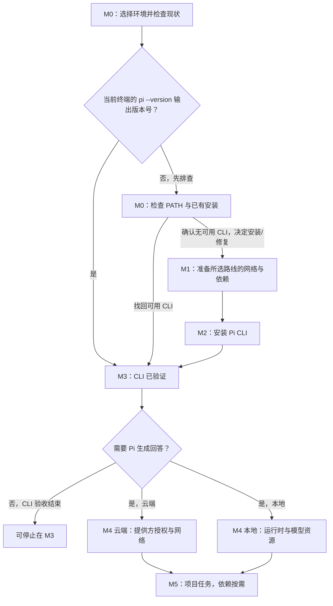

<a id="learning-map"></a>
<a id="1-学习地图"></a>

# Pi CLI 上手指南：按依赖与里程碑安装并使用

## 字多不看

- 先完成 M0：选择实际终端并检查已有安装；确认当前终端没有可用 CLI 且决定安装/修复后，再走 M1（路线依赖）和 M2，最后用 M3 验证。
- M4（模型可回答）不是 CLI 安装验证的前置条件；需要 Pi 生成回答时再做。M5（项目任务）还依赖项目本身的授权和任务专属工具。
- 常规官方安装/更新和云端模型需要联网；安装服务与所选模型服务分开。准备好的本地模型可能离线使用。
- 官方安装器及 npm 路线要求 Node.js 22.19.0 或更高版本和 npm；Git Bash 仅在 Windows 原生需要 Bash 工具时考虑，WSL 与 Nix 是可选路线。
- Pi 以启动账户权限运行，不是安全沙箱。不要以管理员/root 启动，不分享凭据，检查实际命令与改动。

<a id="milestone-map"></a>

## 依赖图与里程碑

图表示首次安装与使用的条件依赖，不要求所有人走完每个节点。若 `pi --version` 没有输出版本号，先在 M0 区分 PATH/终端问题、已有安装故障与没有可用 CLI；确认需要安装/修复后才进入 M1 和 M2。



附加分支：原生 Windows 的项目任务若需要 Pi Bash 工具，M5 还需要 Pi 可发现的 Bash（默认 Git Bash）；它不是 M2/M3 的前置条件，选择和安装方式见 M1。

- **M0：环境与现状。** 所有人完成：选择目标操作系统/终端，检查 `pi --version`，区分命令未解析、已有安装故障和没有可用 CLI。
- **M1：路线与必要条件。** M0 确认需要安装/修复后进入：选择官方安装器、npm 或已在使用的 Nix 路线，按路线核对 Node/npm、网络目标和可选工具依赖；Git Bash 只在对应任务需要时配置。
- **M2：CLI 安装。** 依赖 M1；所选安装方式报告完成后进入 M3。本机验证仍是独立验收。
- **M3：CLI 验证。** 依赖已有安装或 M2；在目标终端运行 `pi --version` 并看到版本号。
- **M4：模型可回答。** 依赖 M3 和云端/本地其中一条模型路线；只验 CLI 时可跳过。按路线完成必要授权/配置，选择可用模型并得到一条简单回答；这不代表项目任务完成。
- **M5：项目任务。** 依赖 M3、M4 和有权访问的项目；按任务验收标准检查真实改动、运行结果和测试，只安装任务确实需要的依赖。

## 快速导航

1. [依赖图与里程碑](#milestone-map)
2. [M0：选择环境并检查现状](#milestone-0)
3. [M1：准备路线依赖](#milestone-1)
4. [M2：安装 Pi CLI](#milestone-2)
5. [M3：验证 CLI](#milestone-3)
6. [M4：连接模型](#milestone-4)
7. [M5：在项目中使用](#milestone-5)
8. [常见问题](#常见问题)
9. [卸载 Pi（可选）](#uninstall-pi)
10. [官方资料](#官方资料)
11. [网页 AI 单步引导提示词](#web-ai-walkthrough-prompt)
12. [可选练习：第一个项目](first-project.md)

<a id="准备与系统要求"></a>
<a id="milestone-0"></a>

## M0：选择环境并检查现状

CLI 可用、模型可回答和项目任务完成是三个独立验收点；上方依赖图说明何时跳过或进入后续里程碑。

Pi 官方 Quickstart 支持 macOS、Linux，并为 Windows 提供独立说明；Windows 可原生运行，也可在 WSL 内运行。选择你实际准备使用的终端；不要因为安装 Pi 就默认安装 WSL。

| 项目 | 要求或选择 | 说明 |
|:---|:---|:---|
| macOS | Terminal、`curl` 与 POSIX shell | 使用 Pi 官方 shell 安装器。 |
| Linux | 终端、`curl` 与 POSIX shell | 使用 Pi 官方 shell 安装器。 |
| Windows 原生 | PowerShell | 使用 Pi 官方 PowerShell 安装器；Windows 原生与 WSL 是两种独立环境。 |
| Node.js 与 npm | 官方主安装器及 npm 路线要求 Node.js 22.19.0 或更高版本和 npm | 缺少时，交互式安装器可提供安装路线；平台选择见 M2。 |
| Windows 原生 Bash | 仅在需要 Pi 内置 Bash 工具或 `!` 命令时需要 Pi 可发现的 Bash（默认 Git Bash） | 不是 CLI 前置条件；按 M1 的可选说明决定，安装器也可能在 M2 询问。 |
| Nix | 已经使用 Nix 的 macOS/Linux 用户可选 | 不需要为 Pi 专门安装 Nix。 |
| WSL、Git、Python、编辑器 | 按工作环境或具体项目选择 | 均不是安装 Pi CLI 的普遍前置条件。 |
| 网络 | 常规官方安装/更新与云端模型调用需要可用网络 | 安装源、包源和模型服务不同；本地版本检查及已准备好的本地模型可能离线。 |

在准备使用的普通用户终端运行：

```bash
pi --version
```

Windows PowerShell 也运行同一条命令。若出现版本号，当前终端已满足 M3 验收，可跳过 M1/M2；若找不到命令，先关闭并重新打开该终端，再做只读查找：macOS/Linux/WSL 的 POSIX shell 用 `command -v pi`，Windows PowerShell 用 `Get-Command pi -ErrorAction SilentlyContinue`。有输出表示 shell 能解析同名命令，不单独证明 `pi --version` 已成功；无输出时核对安装器报告的路径。确认当前终端没有可用 CLI 且决定安装/修复后才进入 M1/M2；若发现路径但版本检查仍失败，先按真实报错诊断，不要盲目重装。不要把完整 PATH 或含用户名的本机路径贴给 AI；分享前先脱敏。不要以管理员/root 身份运行安装器。

<a id="network-and-dependencies"></a>
<a id="milestone-1"></a>

## M1：准备所选路线的网络与依赖

常规官方安装和更新需要联网访问相应分发源；这不是所有里程碑共用的单一网络条件。M1 核对安装路线，M4 再核对所选模型服务。

| 阶段 | 需要访问的服务（依安装路线） | 说明 |
|:---|:---|:---|
| 获取安装脚本和 Pi 发布信息 | Pi 官方 `pi.dev` 域名 | 使用下文列出的官方地址，不从第三方脚本站下载。 |
| 获取 Pi 包及依赖 | npm 官方包分发服务（通常为 `registry.npmjs.org`） | 官方托管安装会安装锁定的依赖。 |
| 自动安装 Node 或系统依赖 | Node.js 官方分发服务，或当前系统选择的包管理器源 | 是否访问取决于系统、已有 Node/npm 和安装器选择；系统包安装可能要求你确认权限。 |
| Windows 可选安装 Git Bash | 选择 Portable Git 时可能访问 `api.github.com` 和 GitHub 发布资产；若明确选择 winget，则使用其配置的包源 | 只有选择安装 Git Bash 时才涉及，不是 Pi CLI 安装本身的要求。具体下载地址以官方安装器当前输出为准。 |
| 已有 Nix 用户的可选路线 | GitHub 与本机 Nix 配置的缓存/包源 | 只有选择 Nix 路线时涉及。 |

浏览器能够打开 Pi 官方文档，只能证明浏览器可访问；不能保证当前终端或包源可访问。模型服务的网络属于 M4，安装与模型登录要分别看实际结果。

Pi 官方资料没有覆盖所有平台、安装选项和模型提供方的通用网络白名单。M1 根据安装器实际报错核对安装源；M4 根据所选提供方的报错核对模型服务。公司/学校网络若拦截请求，应确认具体目标并遵守网络管理员要求；不要默认购买代理、启用全局代理/TUN、关闭 TLS/安全软件或换用来历不明的镜像。不要把代理口令或含凭据的日志发给 AI。

### Windows 原生 Bash 工具（可选依赖）

只有原生 Windows 上的任务需要 Pi 内置 Bash 工具或 `!` 命令时，才需要 Pi 能发现的 Bash（默认是 Git Bash）；它不是 CLI 安装条件。若 M2 安装器询问，可按需选择：Portable Git（放在 Pi 用户目录并修改 `~/.pi/agent/settings.json` 的 `shellPath`）、winget 全局安装 Git for Windows（仅当 winget 可用），或跳过。也可自行安装[官方 Git for Windows](https://git-scm.com/download/win)。如果系统没有其他可被 Pi 发现的 Bash，跳过将使 Bash 工具不可用，但不影响 CLI。WSL 是另一种独立环境，不是 CLI 或 Git Bash 的前置条件。

<a id="pi-cli-installation"></a>
<a id="milestone-2"></a>

## M2：安装 Pi CLI

先确认命令来自 [Pi 官方 Quickstart](https://pi.dev/docs/latest/quickstart)、[Windows 说明](https://pi.dev/docs/latest/windows)或[官方仓库 README](https://github.com/earendil-works/pi)。下面的 `curl | sh` 和 `irm | iex` 会把下载的脚本交给 shell 执行；核对域名和安装器提示。使用普通用户的交互式终端，不要用 `sudo` 或“以管理员身份运行”包装安装命令。

### macOS

在普通用户的 Terminal 中运行：

```bash
curl -fsSL https://pi.dev/install.sh | sh
```

安装器要求 Node.js 22.19.0 或更高版本和 npm；缺少时会询问是否安装。macOS 上若已有 Homebrew，安装器可能用它安装或更新 Node；否则会提供用户目录中的独立 Node 安装路线。不要为了 Pi 专门安装 Homebrew。读清安装器将执行的动作；不接受时取消，再从 [Node.js 官方下载页](https://nodejs.org/en/download)安装合格的 Node.js 和 npm 后重试。安装器若询问是否立即启动 Pi，可先选择暂不启动。官方安装器管理的 Pi 后续用 `pi update` 更新。

### Linux

在普通用户的 Linux 终端中运行：

```bash
curl -fsSL https://pi.dev/install.sh | sh
```

安装器要求 Node.js 22.19.0 或更高版本和 npm；缺少时会说明并询问是否安装。安装路线可能使用满足版本要求的 apt/apk 包，或用户目录中的独立 Node；系统包安装可能调用 `sudo`，读清提示后再决定。若不接受系统级动作，取消安装器，从 [Node.js 官方下载页](https://nodejs.org/en/download)安装合格的 Node.js 和 npm，再重试。不要用 `sudo curl ... | sh` 包装 Pi 安装命令。官方安装器管理的 Pi 后续用 `pi update` 更新。

### Windows 原生 PowerShell

在普通用户 PowerShell 中运行：

```powershell
powershell -c "irm https://pi.dev/install.ps1 | iex"
```

安装器要求 Node.js 22.19.0 或更高版本和 npm；若缺少，会询问是否安装独立 Node.js，并把它放在用户目录、加入当前用户 PATH。默认托管安装后可用 `pi update` 更新。若安装器显示更新、重装、卸载或迁移已有 Pi，先核对当前版本和目标路径，不要盲目接受；主动卸载时按[卸载 Pi](#uninstall-pi)说明操作。

若安装器询问 Git Bash 的安装方式，按 M1 的可选依赖说明决定；若系统没有其他可被 Pi 发现的 Bash，跳过将使 Bash 工具不可用，但不影响 CLI。若询问是否立即启动 Pi，可先暂不启动，之后按 M3 验证。

### WSL（可选）

如果你已经在 WSL 中开发，在目标发行版的 Linux 终端按上面的 Linux 路线安装。Windows 原生与 WSL 的安装目录和 PATH 相互独立；不要仅为安装 Pi 而配置 WSL，也不要在两个终端之间混用安装结果。

### 其他官方安装路线（可选）

- 已经使用 Nix 的 macOS/Linux 用户可按 [Pi Quickstart 的 Nix 说明](https://pi.dev/docs/latest/quickstart)安装。Nix 会按 Nix 路线更新，`pi update` 不负责更新 Nix 安装。
- 已有合格 Node.js 和 npm 的用户可使用官方 npm 备选命令：

```bash
npm install -g --ignore-scripts @earendil-works/pi-coding-agent
```

官方 Quickstart 指出 npm 安装不会锁定传递依赖，新手通常优先使用平台安装器。全局 npm 权限报错时不要用 `sudo npm` 硬修；先停止，改选平台安装器或用户级 Node 环境。

<a id="verify-and-connect-a-model"></a>
<a id="milestone-3"></a>

## M3：验证 CLI 可用

在目标终端运行：

```bash
pi --version
```

看到版本号即达成 M3；它只证明 CLI 可运行，不证明模型已授权或项目任务已完成。若此处失败，回到 [M0](#milestone-0) 区分 PATH/终端问题与安装失败，不要盲目重装。

<a id="milestone-4"></a>

## M4：连接模型（需要 Pi 生成回答时）

### 云端模型路线（按需）

若需要 Pi 生成回答，按所选提供方当前说明完成认证。若使用 Pi 的交互式登录，在终端启动 `pi` 后，于 Pi 界面运行：

```text
/login
```

云端模型需要当前终端访问所选提供方的认证与推理服务；本仓主路线 Pi + OpenAI GPT 对应 OpenAI 服务，目标与 M1 的安装源不同。具体网络条件以所选提供方当前说明和实际报错为准。本仓主路线选择你有权使用且当前可用的 OpenAI 认证方式；也可以选择其他受支持的提供方。完成必要授权后，用 `/model` 选择可用模型，并发送一条不要求修改文件的简单问题。ChatGPT 订阅不应被自动当成 OpenAI API 额度；不同路线的账号权限与费用不同。

若用 API Key，优先选择受信凭据管理器和 Pi 官方支持的安全读取方式；若通过 Pi 的 `/login` 交互录入，凭据可能保存在 `~/.pi/agent/auth.json`。该文件可能含 API Key 或 OAuth Token，必须保持私密，不得提交、上传或复制给网页 AI。不要把密钥、密码、Token、cookie、订阅链接或带凭据的截图贴进对话，也不要把凭据写进项目文件、脚本或 shell 配置。

### 本地模型路线（按需）

若选择本地模型，按所选提供方的 Pi 官方说明准备本地运行时与模型资源，并完成该路线所需配置；这不是 Pi CLI 安装的一部分，也不一定使用云端 `/login` 流程。依赖已准备好且无需远端服务时，本地模型可能离线使用。

M4 完成信号：所选模型对一条不要求修改文件的简单问题返回回答。只验证 CLI 时可跳过 M4。

<a id="post-install-use"></a>
<a id="milestone-5"></a>

## M5：在项目中使用

1. 进入你有权让 Pi 访问的项目目录，再运行 `pi`。在本仓库工作时，可从仓库根目录运行 `pi --skill .github/skills`，显式加载仓库 Skills；这不会把 `.github/extensions/` 整体作为 Pi 原生扩展加载。详见[根 README](../../../README.md)。不要以管理员/root 身份启动。
2. 用自然语言说明目标、当前状态、限制和验收标准。可以先要求 Pi 只检查现有环境和项目文件，报告所需工具、计划、风险与验证方式，暂不安装或修改。
3. 只配置当前任务确实需要的 Git、语言运行时、编辑器或项目依赖；Pi CLI 安装不意味着每个项目都要安装 Node.js、Python、Git 或某个编辑器。
4. 对系统级安装、外部服务、凭据、删除/覆盖等有副作用的动作，先看清对象和影响，再由你明确决定是否继续。Pi 的工具以启动账户权限运行，不保证每条命令都先征得确认；工作目录不是安全沙箱。
5. 检查实际命令、文件改动和测试输出。没有真实验证证据时，不把项目任务说成已完成。

M5 的完成信号由具体任务的验收标准决定；CLI 能运行或模型能回答都不等于项目任务完成。可选练习：[第一个项目](first-project.md)用本地待办清单练习需求、运行、验收和 Git 保存；它不是 Pi CLI 安装条件。

可以把下面的开场要求交给本地 Pi：

```text
请先查看当前项目的说明文件和现有环境，围绕【我的目标】列出完成任务所必需的最小步骤、可能影响和验证方式。先检查并报告，不要安装依赖、修改系统、访问外部服务或改文件；等我确认后再逐项执行。不要读取或输出凭据；遇到系统权限、外部副作用或不可逆动作时先停下说明。完成后给出实际改动和验证结果。
```

## 常见问题

| 现象 | 先区分什么 | 安全的下一步 |
|:---|:---|:---|
| `pi` 命令找不到 | 可能是 PATH/终端问题、已有安装故障或没有可用 CLI | 按[M0](#milestone-0)做只读检查；确认没有可用 CLI 且决定安装/修复后才走 M1/M2，不要盲目重装。 |
| 安装器报告 Node/npm 缺失或版本过低 | 安装路线前置条件，不是模型登录问题 | 按[M1](#milestone-1)确认路线，再按 M2 的平台选项和安装器提示处理。 |
| 官方安装源超时或被拒绝 | 访问安装源、包分发、Node 下载或系统包源中的哪一步 | 按[M1](#milestone-1)核对实际失败的官方来源；记录脱敏报错，不关闭 TLS 或改用未知脚本。 |
| CLI 能启动但模型不能回答 | CLI 安装与模型授权/可用性是不同阶段 | 按[M4](#milestone-4)检查所选路线的必要授权/配置、`/model`、网络和提供方权限；不要重新安装 CLI，也不要发送凭据。 |
| Windows 上 `pi --version` 成功，但 Pi 报 Bash 不可用 | CLI 与 Bash 工具是不同问题 | 按[M1](#milestone-1)的可选依赖说明安装/定位 Git Bash，或检查 `~/.pi/agent/settings.json` 的 `shellPath`；无需默认迁移到 WSL。 |
| 网页 AI 让你粘贴密钥或运行来源不明的命令 | 凭据和下载来源风险 | 不提供密钥；回到 Pi 官方页面确认命令。错误信息先脱敏，再提供给 AI。 |

<a id="uninstall-pi"></a>

### 卸载 Pi（可选）

在与安装时相同的系统环境中（Windows 原生与 WSL 分开），按原安装渠道选择官方卸载方式：

- 官方安装器（macOS/Linux shell 或 Windows PowerShell）：重跑 M2 对应的安装器；确认它检测到的是要移除的 Pi 后，再选择 `Uninstall Pi`。
- npm：在安装时使用的全局 npm 环境中运行 `npm uninstall -g @earendil-works/pi-coding-agent`。
- Nix：运行 `nix profile remove pi`。

这些卸载方式不会删除 `~/.pi/agent/` 中的配置、凭据、会话或已安装的 Pi 包。若要保留它们，无需额外操作；若要清理，先备份并检查内容，不要把该目录整体删除当作卸载步骤。

## 官方资料

- [Pi Quickstart：安装、卸载与启动](https://pi.dev/docs/latest/quickstart)
- [Pi Windows：原生 Windows、Git Bash 与 WSL](https://pi.dev/docs/latest/windows)
- [Pi Providers：认证与模型提供方](https://pi.dev/docs/latest/providers)
- [Pi Security：工具权限与安全边界](https://pi.dev/docs/latest/security)
- [Pi 官方安装脚本（macOS/Linux）](https://pi.dev/install.sh)
- [Pi 官方安装脚本（Windows PowerShell）](https://pi.dev/install.ps1)
- [Node.js 官方下载页](https://nodejs.org/en/download)
- [Git for Windows 官方下载页](https://git-scm.com/download/win)

<a id="web-ai-walkthrough-prompt"></a>

## 网页 AI 单步引导提示词

复制下面整段到你能使用的网页 AI。网页 AI 不能替你运行或验证本机命令。每次只做一个检查或执行动作，并根据你实际回报继续。

```text
你是我的 Pi CLI 安装和首次使用向导。先核对 Pi 当前官方资料：
- Quickstart：https://pi.dev/docs/latest/quickstart
- Windows：https://pi.dev/docs/latest/windows
- Providers：https://pi.dev/docs/latest/providers
- Security：https://pi.dev/docs/latest/security
- 官方仓库：https://github.com/earendil-works/pi

每次只给我一个检查动作或一条命令，说明在哪个终端运行、目的、可能影响和成功信号，然后停下来等我的实际结果。不要声称你已在我电脑上运行或验证任何内容。

先询问我的操作系统、终端，以及 `pi --version` 是否成功；若我不清楚，只给一个不会修改系统的检查方法。按本文 M0–M5 依赖图只推进当前未满足的里程碑：已有 CLI 时跳过 M1/M2；M4 只在需要模型回答时进行；M5 只配置具体项目任务所需依赖。若命令找不到，先做 M0 的只读 PATH/安装位置检查，不要直接重装。不要预设我必须使用 WSL、Git、Python、编辑器、代理或项目依赖。只用官方安装方式；常规安装/更新和云端模型需要网络，安装源、包源、模型服务要分别核对，不猜白名单或代理。`curl | sh` 或 `irm | iex` 会下载并执行脚本，先让我核对官方域名。

官方安装器与 npm 路线要求 Node.js 22.19.0 或更高版本和 npm。若安装器准备安装 Node、调用系统包管理器、改 PATH/shell 配置、更新/重装/卸载/迁移已有 Pi 或立即启动，先解释精确动作、范围和影响，等我决定。不要以管理员/root 运行，不用 `sudo npm`。Windows 原生 Git Bash 只用于 Pi 的 Bash 工具，WSL 可选；若选择 Portable Git，说明它会写入 Pi 用户目录并修改 `settings.json` 的 `shellPath`；若还有 winget 全局安装或跳过选项，解释差异后等我选择。只有我已在使用 Nix 时才推荐 Nix。

不要向我索取或复述密码、API Key、Token、cookie、订阅链接、私钥或授权码；我只在本地 Pi 的可信流程里自行处理凭据，并在分享结果前脱敏。CLI 安装、模型路线所需授权/配置与 `/model` 选择、项目任务是不同验收。ChatGPT 订阅不自动代表 OpenAI API 额度。Pi 使用启动账户权限，不是安全沙箱；项目中只配置当前任务必需的工具，涉及系统修改、外部服务或不可逆操作时先停下让我决定。

遇到错误时一次只排查一个问题，先根据操作系统、终端、当前里程碑、命令和已脱敏报错诊断；不要盲目重装、提高权限、关闭 TLS/安全软件或使用未知脚本。无法核对官方资料时明确说明，不要编造。

现在只询问操作系统、终端和 `pi --version` 的实际结果，然后停下来等我回复。
```

## 历史链接说明

<a id="使用仓库配置基线"></a>

旧 Codex 配置基线及其安装/恢复脚本已从仓库移除。此历史锚点仅用于旧链接跳转，不提供安装或恢复命令。
