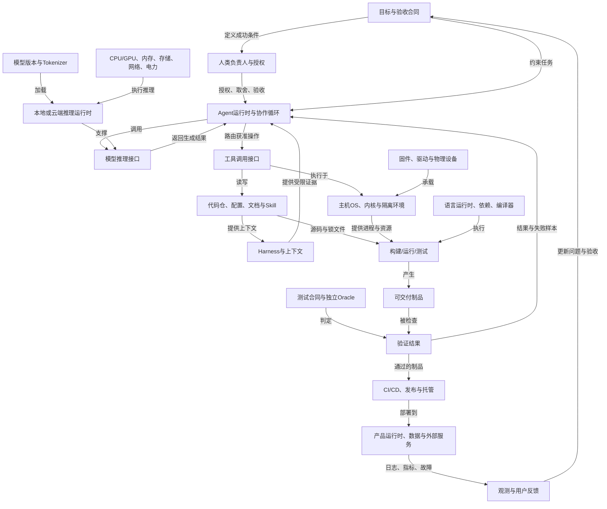

<a id="reference-technology-stack"></a>

# 技术栈

> 技术栈选型、组合案例与学习路径。

> 本文件是技术栈参考入口，帮助读者理解软件系统通常由哪些技术层组成、不同场景如何组合技术栈、初学者应该如何选择学习路径。

<a id="reference-technology-stack-核心摘要"></a>
### 核心摘要

技术栈不是单个框架或语言，而是一组完成系统交付所需的技术组合，包括前端、后端、数据库、缓存、部署、监控、测试、AI、数据工程、安全和运维工具。选择技术栈时，不只看技术是否流行，还要看项目目标、团队能力、维护成本、生态成熟度、部署环境、合规要求和替换路径。

本文件适合三类场景：新手建立技术全景，开发者为项目选型，Agent 在生成方案前理解“应该优先复用哪些成熟技术组合”。

<a id="reference-technology-stack-顶部导航"></a>
### 顶部导航

| 主题 | 用途 |
|:---|:---|
| [什么是技术栈](#一什么是技术栈) | 建立基本概念，理解技术组合而非单点技术 |
| [技术栈通常包含哪些部分](#二技术栈通常包含哪些部分) | 前端、后端、数据库、部署、AI、数据、安全等层级 |
| [常见项目对应技术栈](#十三常见项目对应技术栈) | Web、移动端、桌面端、全栈、游戏、数据工程等组合案例 |
| [如何选择技术栈](#十四如何选择技术栈) | 从目标、约束、团队能力、生态成熟度和长期维护评估方案 |
| [初学者应该学什么技术栈](#十五初学者应该学什么技术栈) | 从可交付项目出发，选择最小必要技术路线 |

<a id="reference-technology-stack-使用方式"></a>
### 使用方式

- 做新项目选型时，先按项目类型定位候选技术栈，再用维护成本和成熟度筛选。
- 给 AI 提需求时，把目标平台、团队能力、部署环境、数据规模和必须规避的技术写清楚。
- 当成熟技术栈能满足需求时，遵循拼好码原则，优先复用成熟方案，不默认自研底层能力。

<a id="reference-technology-stack-一什么是技术栈"></a>
### 一、什么是技术栈

**技术栈**，英文叫 **Technology Stack**，指开发一个软件系统时使用的一整套技术、框架、语言、工具和平台。

它不是单独某一种技术，而是一个组合。

例如，一个网站可能会用：

* 前端：React、TypeScript、Tailwind CSS
* 后端：Java、Spring Boot
* 数据库：MySQL、Redis
* 部署：Docker、Nginx、Kubernetes
* 云服务：AWS
* 工具：Git、GitHub Actions

这些合起来，就是这个项目的技术栈。

---

<a id="reference-technology-stack-二技术栈通常包含哪些部分"></a>
### 二、技术栈通常包含哪些部分

<a id="reference-technology-stack-1-前端技术栈"></a>
### 1. 前端技术栈

前端负责用户看到的页面和交互。

常见内容包括：

<a id="reference-technology-stack-基础语言"></a>
#### 基础语言

* HTML：页面结构
* CSS：页面样式
* JavaScript：页面交互
* TypeScript：JavaScript 的增强版，更适合大型项目

<a id="reference-technology-stack-前端框架"></a>
#### 前端框架

* React
* Vue
* Angular
* Svelte
* SolidJS

<a id="reference-technology-stack-ui-框架和组件库"></a>
#### UI 框架和组件库

* Tailwind CSS
* Bootstrap
* Ant Design
* Element Plus
* Material UI
* Shadcn UI

<a id="reference-technology-stack-构建工具"></a>
#### 构建工具

* Vite
* Webpack
* Rollup
* Parcel
* esbuild

<a id="reference-technology-stack-状态管理"></a>
#### 状态管理

* Redux
* Zustand
* Pinia
* Vuex
* MobX
* Recoil

<a id="reference-technology-stack-前端路由"></a>
#### 前端路由

* React Router
* Vue Router
* Next.js Router
* Nuxt Router

<a id="reference-technology-stack-前端请求工具"></a>
#### 前端请求工具

* Fetch API
* Axios
* TanStack Query
* SWR

<a id="reference-technology-stack-前端测试"></a>
#### 前端测试

* Jest
* Vitest
* Cypress
* Playwright
* Testing Library

<a id="reference-technology-stack-前端常见组合"></a>
#### 前端常见组合

React 技术栈：

> React + TypeScript + Vite + Tailwind CSS + Zustand + Axios

Vue 技术栈：

> Vue 3 + TypeScript + Vite + Pinia + Vue Router + Element Plus

企业级前端技术栈：

> React + TypeScript + Next.js + Tailwind CSS + Shadcn UI + TanStack Query

---

<a id="reference-technology-stack-2-后端技术栈"></a>
### 2. 后端技术栈

后端负责业务逻辑、接口、权限、数据处理、文件处理、支付、消息通知等。

<a id="reference-technology-stack-常见后端语言"></a>
#### 常见后端语言

* Java
* Python
* JavaScript / TypeScript
* Go
* PHP
* C#
* Ruby
* Rust
* Kotlin
* Scala

<a id="reference-technology-stack-java-后端"></a>
#### Java 后端

常见技术：

* Spring Boot
* Spring MVC
* Spring Cloud
* MyBatis
* MyBatis-Plus
* Hibernate / JPA
* Maven
* Gradle

常见组合：

> Java + Spring Boot + MyBatis-Plus + MySQL + Redis

适合场景：

* 企业系统
* 电商平台
* 金融系统
* 大型后台系统
* 微服务架构

---

<a id="reference-technology-stack-python-后端"></a>
#### Python 后端

常见技术：

* Django
* Flask
* FastAPI
* SQLAlchemy
* Celery
* Pydantic
* Poetry

常见组合：

> Python + FastAPI + PostgreSQL + Redis + Celery

适合场景：

* API 服务
* 数据平台
* AI 应用
* 自动化工具
* 中小型 Web 后端

---

<a id="reference-technology-stack-nodejs-后端"></a>
#### Node.js 后端

常见技术：

* Express
* NestJS
* Koa
* Fastify
* Prisma
* TypeORM
* Sequelize

常见组合：

> Node.js + NestJS + TypeScript + Prisma + PostgreSQL

适合场景：

* 前后端统一 TypeScript
* 实时应用
* 中台系统
* API 服务
* 初创项目

---

<a id="reference-technology-stack-go-后端"></a>
#### Go 后端

常见技术：

* Gin
* Echo
* Fiber
* GORM
* Go kit
* gRPC

常见组合：

> Go + Gin + PostgreSQL + Redis + Docker

适合场景：

* 高并发服务
* 云原生系统
* 微服务
* 网关
* 基础设施工具

---

<a id="reference-technology-stack-php-后端"></a>
#### PHP 后端

常见技术：

* Laravel
* Symfony
* ThinkPHP
* Composer

常见组合：

> PHP + Laravel + MySQL + Redis

适合场景：

* 内容管理系统
* 企业官网
* 电商网站
* 快速 Web 开发

---

<a id="reference-technology-stack-c-后端"></a>
#### C# 后端

常见技术：

* ASP.NET Core
* Entity Framework Core
* LINQ
* NuGet

常见组合：

> C# + ASP.NET Core + SQL Server + Redis

适合场景：

* 企业系统
* Windows 生态
* 内部管理系统
* 大型后端服务

---

<a id="reference-technology-stack-3-数据库技术栈"></a>
### 3. 数据库技术栈

数据库负责存储、查询和管理数据。

<a id="reference-technology-stack-关系型数据库"></a>
### 关系型数据库

适合结构化数据。

常见数据库：

* MySQL
* PostgreSQL
* SQL Server
* Oracle
* SQLite
* MariaDB

适合存储：

* 用户信息
* 订单信息
* 商品信息
* 交易记录
* 权限数据

常见组合：

> MySQL + Redis
> PostgreSQL + Prisma
> SQL Server + Entity Framework

---

<a id="reference-technology-stack-非关系型数据库"></a>
### 非关系型数据库

适合灵活结构、文档、键值、图数据等。

<a id="reference-technology-stack-文档数据库"></a>
#### 文档数据库

* MongoDB
* CouchDB

适合：

* 内容数据
* 配置数据
* 半结构化数据

<a id="reference-technology-stack-键值数据库"></a>
#### 键值数据库

* Redis
* Memcached

适合：

* 缓存
* Session
* 排行榜
* 验证码
* 分布式锁

<a id="reference-technology-stack-搜索引擎"></a>
#### 搜索引擎

* Elasticsearch
* OpenSearch
* Solr

适合：

* 全文搜索
* 日志检索
* 商品搜索
* 数据分析

<a id="reference-technology-stack-图数据库"></a>
#### 图数据库

* Neo4j
* ArangoDB

适合：

* 社交关系
* 推荐系统
* 知识图谱
* 风控关系分析

<a id="reference-technology-stack-时序数据库"></a>
#### 时序数据库

* InfluxDB
* TimescaleDB
* Prometheus

适合：

* 监控数据
* 物联网数据
* 设备指标
* 时间序列分析

---

<a id="reference-technology-stack-三移动端技术栈"></a>
### 三、移动端技术栈

移动端负责开发手机 App。

<a id="reference-technology-stack-ios-原生开发"></a>
### iOS 原生开发

语言和工具：

* Swift
* Objective-C
* Xcode
* SwiftUI
* UIKit

适合：

* iPhone App
* iPad App
* Apple Watch App
* 高性能 iOS 应用

组合：

> Swift + SwiftUI + Combine + CoreData

---

<a id="reference-technology-stack-android-原生开发"></a>
### Android 原生开发

语言和工具：

* Kotlin
* Java
* Android Studio
* Jetpack Compose
* XML Layout

适合：

* Android 手机 App
* 平板 App
* Android TV
* 原生高性能应用

组合：

> Kotlin + Jetpack Compose + Retrofit + Room

---

<a id="reference-technology-stack-跨平台移动开发"></a>
### 跨平台移动开发

一套代码开发多个平台。

常见技术：

* Flutter
* React Native
* Ionic
* Expo
* Kotlin Multiplatform
* .NET MAUI

常见组合：

> Flutter + Dart + Firebase
> React Native + TypeScript + Expo

适合：

* 初创产品
* 多端快速开发
* 中小型 App
* 需要同时支持 iOS 和 Android 的项目

---

<a id="reference-technology-stack-四桌面端技术栈"></a>
### 四、桌面端技术栈

桌面端用于开发 Windows、macOS、Linux 软件。

常见技术：

* Electron
* Tauri
* Qt
* WPF
* WinUI
* JavaFX
* Avalonia
* Flutter Desktop

常见组合：

> Electron + React + TypeScript
> Tauri + Rust + Vue
> C# + WPF + SQL Server
> Qt + C++

适合：

* 桌面客户端
* 编辑器
* 企业内部软件
* 跨平台工具
* 即时通讯软件

---

<a id="reference-technology-stack-五全栈技术栈"></a>
### 五、全栈技术栈

全栈是指前端、后端、数据库、部署都能覆盖。

常见全栈组合：

<a id="reference-technology-stack-mern"></a>
### MERN

> MongoDB + Express + React + Node.js

适合：

* 初创项目
* SaaS
* Web 应用
* 快速原型

<a id="reference-technology-stack-mean"></a>
### MEAN

> MongoDB + Express + Angular + Node.js

适合：

* 企业级前端
* 大型后台系统

<a id="reference-technology-stack-mevn"></a>
### MEVN

> MongoDB + Express + Vue + Node.js

适合：

* Vue 项目
* 中小型 Web 应用

<a id="reference-technology-stack-pern"></a>
### PERN

> PostgreSQL + Express + React + Node.js

适合：

* 结构化数据较多的 Web 应用
* SaaS
* 管理后台

<a id="reference-technology-stack-t3-stack"></a>
### T3 Stack

> TypeScript + Next.js + tRPC + Prisma + Tailwind CSS

适合：

* 类型安全的全栈项目
* 现代 Web 应用
* 快速开发

<a id="reference-technology-stack-django-全栈"></a>
### Django 全栈

> Python + Django + PostgreSQL + Redis + Celery

适合：

* 内容平台
* 管理系统
* 数据型应用
* 中小企业系统

<a id="reference-technology-stack-spring-boot-全栈"></a>
### Spring Boot 全栈

> Java + Spring Boot + Vue / React + MySQL + Redis

适合：

* 企业系统
* 电商平台
* 后台管理系统
* 中大型项目

---

<a id="reference-technology-stack-六devops-和部署技术栈"></a>
### 六、DevOps 和部署技术栈

DevOps 负责让项目自动化构建、测试、部署、监控和运维。

<a id="reference-technology-stack-操作系统"></a>
### 操作系统

* Linux
* Ubuntu
* CentOS
* Debian
* Alpine Linux
* Windows Server

<a id="reference-technology-stack-web-服务器"></a>
### Web 服务器

* Nginx
* Apache
* Caddy
* IIS

<a id="reference-technology-stack-容器技术"></a>
### 容器技术

* Docker
* Docker Compose
* Podman

<a id="reference-technology-stack-容器编排"></a>
### 容器编排

* Kubernetes
* Docker Swarm
* Nomad
* OpenShift

<a id="reference-technology-stack-cicd"></a>
### CI/CD

* GitHub Actions
* GitLab CI
* Jenkins
* CircleCI
* Travis CI
* Argo CD
* Tekton

<a id="reference-technology-stack-云平台"></a>
### 云平台

* AWS
* Microsoft Azure
* Google Cloud
* 阿里云
* 腾讯云
* 华为云
* Cloudflare
* Vercel
* Netlify
* Railway
* Render
* Fly.io

<a id="reference-technology-stack-基础设施即代码"></a>
### 基础设施即代码

* Terraform
* Pulumi
* Ansible
* Chef
* Puppet

<a id="reference-technology-stack-监控和日志"></a>
### 监控和日志

* Prometheus
* Grafana
* ELK Stack
* Loki
* Datadog
* New Relic
* Sentry
* OpenTelemetry

常见部署组合：

> Docker + Nginx + GitHub Actions + AWS
> Kubernetes + Helm + Argo CD + Prometheus + Grafana
> Vercel + Next.js + Supabase

---

<a id="reference-technology-stack-七ai-机器学习技术栈"></a>
### 七、AI / 机器学习技术栈

AI 技术栈用于机器学习、深度学习、大模型应用、数据处理等。

<a id="reference-technology-stack-编程语言"></a>
### 编程语言

* Python
* R
* Julia
* C++
* Scala

<a id="reference-technology-stack-数据处理"></a>
### 数据处理

* NumPy
* Pandas
* Polars
* Dask
* Spark

<a id="reference-technology-stack-机器学习"></a>
### 机器学习

* Scikit-learn
* XGBoost
* LightGBM
* CatBoost

<a id="reference-technology-stack-深度学习"></a>
### 深度学习

* PyTorch
* TensorFlow
* Keras
* JAX

<a id="reference-technology-stack-大模型应用"></a>
### 大模型应用

* OpenAI API
* Anthropic API
* Gemini API
* LangChain
* LlamaIndex
* Haystack
* Transformers
* vLLM
* Ollama
* Hugging Face

<a id="reference-technology-stack-向量数据库"></a>
### 向量数据库

* Pinecone
* Weaviate
* Milvus
* Qdrant
* Chroma
* FAISS

<a id="reference-technology-stack-mlops"></a>
### MLOps

* MLflow
* Kubeflow
* Weights & Biases
* DVC
* Airflow
* Prefect

常见 AI 应用栈：

> Python + FastAPI + OpenAI API + PostgreSQL + Redis + Docker

RAG 应用栈：

> LangChain + OpenAI API + Chroma / Pinecone + FastAPI + React

机器学习训练栈：

> Python + Pandas + Scikit-learn + XGBoost + MLflow

深度学习训练栈：

> Python + PyTorch + Transformers + Hugging Face + Weights & Biases

---

<a id="reference-technology-stack-八数据工程技术栈"></a>
### 八、数据工程技术栈

数据工程负责采集、清洗、存储、计算和分析数据。

<a id="reference-technology-stack-数据采集"></a>
### 数据采集

* Kafka
* RabbitMQ
* Flume
* Logstash
* Debezium

<a id="reference-technology-stack-数据存储"></a>
### 数据存储

* Hadoop HDFS
* Amazon S3
* MinIO
* Hive
* HBase

<a id="reference-technology-stack-数据计算"></a>
### 数据计算

* Spark
* Flink
* Presto
* Trino
* Beam

<a id="reference-technology-stack-数据仓库"></a>
### 数据仓库

* Snowflake
* BigQuery
* Redshift
* ClickHouse
* Doris
* StarRocks

<a id="reference-technology-stack-数据调度"></a>
### 数据调度

* Airflow
* Prefect
* Dagster
* DolphinScheduler
* Azkaban

<a id="reference-technology-stack-数据可视化"></a>
### 数据可视化

* Tableau
* Power BI
* Superset
* Metabase
* Looker

常见组合：

> Kafka + Spark + Hive + Airflow + Superset
> dbt + Snowflake + Airflow + Tableau
> Flink + Kafka + ClickHouse + Grafana

---

<a id="reference-technology-stack-九游戏开发技术栈"></a>
### 九、游戏开发技术栈

游戏开发技术栈包括游戏引擎、图形渲染、物理系统、网络通信等。

<a id="reference-technology-stack-游戏引擎"></a>
### 游戏引擎

* Unity
* Unreal Engine
* Godot
* Cocos Creator

<a id="reference-technology-stack-游戏开发语言"></a>
### 游戏开发语言

* C#
* C++
* Lua
* GDScript
* JavaScript
* Python

<a id="reference-technology-stack-图形技术"></a>
### 图形技术

* OpenGL
* Vulkan
* DirectX
* Metal
* WebGPU

<a id="reference-technology-stack-常见组合"></a>
### 常见组合

Unity 游戏：

> Unity + C# + Blender + Photon

Unreal 游戏：

> Unreal Engine + C++ + Blueprint + Quixel

Web 游戏：

> Phaser + JavaScript + WebGL

---

<a id="reference-technology-stack-十嵌入式和物联网技术栈"></a>
### 十、嵌入式和物联网技术栈

用于硬件设备、传感器、智能家居、工业控制等。

<a id="reference-technology-stack-编程语言-2"></a>
### 编程语言

* C
* C++
* Rust
* MicroPython
* Assembly

<a id="reference-technology-stack-硬件平台"></a>
### 硬件平台

* Arduino
* Raspberry Pi
* ESP32
* STM32
* Nordic nRF
* Jetson Nano

<a id="reference-technology-stack-操作系统-2"></a>
### 操作系统

* FreeRTOS
* Zephyr
* Embedded Linux
* RT-Thread

<a id="reference-technology-stack-通信协议"></a>
### 通信协议

* MQTT
* CoAP
* Bluetooth
* Zigbee
* LoRa
* Modbus
* CAN
* HTTP

常见组合：

> ESP32 + FreeRTOS + MQTT + AWS IoT
> STM32 + C + FreeRTOS + CAN
> Raspberry Pi + Python + MQTT + Home Assistant

---

<a id="reference-technology-stack-十一区块链技术栈"></a>
### 十一、区块链技术栈

用于开发智能合约、钱包、去中心化应用等。

<a id="reference-technology-stack-智能合约语言"></a>
### 智能合约语言

* Solidity
* Rust
* Move
* Vyper

<a id="reference-technology-stack-区块链平台"></a>
### 区块链平台

* Ethereum
* Solana
* Polygon
* BNB Chain
* Aptos
* Sui

<a id="reference-technology-stack-开发工具"></a>
### 开发工具

* Hardhat
* Foundry
* Truffle
* Remix

<a id="reference-technology-stack-web3-前端"></a>
### Web3 前端

* ethers.js
* web3.js
* wagmi
* viem
* RainbowKit

常见组合：

> Solidity + Hardhat + ethers.js + React
> Rust + Solana + Anchor + React
> Move + Aptos + TypeScript

---

<a id="reference-technology-stack-十二网络安全技术栈"></a>
### 十二、网络安全技术栈

用于安全测试、防护、审计和监控。

<a id="reference-technology-stack-安全测试"></a>
### 安全测试

* Burp Suite
* OWASP ZAP
* Nmap
* Metasploit
* Wireshark
* SQLMap

<a id="reference-technology-stack-安全开发"></a>
### 安全开发

* OAuth 2.0
* OpenID Connect
* JWT
* HTTPS / TLS
* RBAC
* ABAC

<a id="reference-technology-stack-安全监控"></a>
### 安全监控

* SIEM
* Wazuh
* Splunk
* ELK
* Suricata
* Zeek

<a id="reference-technology-stack-代码安全"></a>
### 代码安全

* SonarQube
* Snyk
* Dependabot
* Trivy
* Checkmarx

---

<a id="reference-technology-stack-十三常见项目对应技术栈"></a>
### 十三、常见项目对应技术栈

<a id="reference-technology-stack-个人博客"></a>
### 个人博客

简单版：

> HTML + CSS + JavaScript

现代版：

> Next.js + Markdown + Tailwind CSS + Vercel

后端版：

> Django + PostgreSQL + Nginx + Docker

---

<a id="reference-technology-stack-企业官网"></a>
### 企业官网

> Vue / React + Tailwind CSS + Nuxt / Next.js + Vercel

---

<a id="reference-technology-stack-后台管理系统"></a>
### 后台管理系统

> Vue 3 + TypeScript + Vite + Pinia + Element Plus
> React + TypeScript + Ant Design + React Router + Axios

---

<a id="reference-technology-stack-电商系统"></a>
### 电商系统

> React / Vue + Java Spring Boot + MySQL + Redis + Elasticsearch + RabbitMQ

---

<a id="reference-technology-stack-即时聊天系统"></a>
### 即时聊天系统

> React + Node.js + WebSocket + Redis + MongoDB

---

<a id="reference-technology-stack-在线教育平台"></a>
### 在线教育平台

> React + Spring Boot + MySQL + Redis + OSS + WebRTC

---

<a id="reference-technology-stack-saas-系统"></a>
### SaaS 系统

> Next.js + TypeScript + PostgreSQL + Prisma + Stripe + Vercel

---

<a id="reference-technology-stack-ai-聊天机器人"></a>
### AI 聊天机器人

> React + FastAPI + OpenAI API + PostgreSQL + Redis + Vector Database

---

<a id="reference-technology-stack-短视频平台"></a>
### 短视频平台

> Flutter / React Native + Go / Java + MySQL + Redis + Kafka + CDN + Object Storage

---

<a id="reference-technology-stack-物联网平台"></a>
### 物联网平台

> ESP32 + MQTT + Node.js / Go + TimescaleDB + Grafana

---

<a id="tech-stack-selection"></a>
<a id="reference-technology-stack-十四如何选择技术栈"></a>
### 十四、如何选择技术栈

选择技术栈时，主要看以下因素：

<a id="reference-technology-stack-1-项目类型"></a>
### 1. 项目类型

不同项目适合不同技术。

网站：

> React、Vue、Next.js、Nuxt

企业系统：

> Java、Spring Boot、Vue、MySQL

AI 应用：

> Python、FastAPI、PyTorch、OpenAI API

移动 App：

> Flutter、React Native、Swift、Kotlin

高并发服务：

> Go、Java、Redis、Kafka

---

<a id="reference-technology-stack-2-团队能力"></a>
### 2. 团队能力

如果团队熟悉 Java，就优先选 Java。

如果团队熟悉 JavaScript，就可以选：

> React + Node.js

如果团队熟悉 Python，就可以选：

> Django / FastAPI

技术栈不是越新越好，而是团队能不能稳定开发和维护。

---

<a id="reference-technology-stack-3-项目规模"></a>
### 3. 项目规模

小项目：

> Vue / React + Firebase / Supabase

中型项目：

> React / Vue + Node.js / Django / Spring Boot + PostgreSQL

大型项目：

> Spring Boot / Go + 微服务 + Kubernetes + Redis + Kafka + Elasticsearch

---

<a id="reference-technology-stack-4-性能要求"></a>
### 4. 性能要求

普通网站：

> Node.js、Python、PHP、Java 都可以

高并发系统：

> Go、Java、Rust、Redis、Kafka

计算密集型系统：

> C++、Rust、Go、Python + C++ 扩展

AI 训练：

> Python + PyTorch + GPU

---

<a id="reference-technology-stack-5-成本"></a>
### 5. 成本

低成本上线：

> Next.js + Vercel + Supabase
> Vue + Firebase
> Django + SQLite / PostgreSQL

企业级部署：

> Kubernetes + 云服务器 + 数据库集群 + CI/CD

---

<a id="reference-technology-stack-6-生态成熟度"></a>
### 6. 生态成熟度

成熟生态通常意味着：

* 教程多
* 问题容易搜索
* 招人容易
* 插件多
* 社区活跃
* 维护成本低

比如：

* Java + Spring Boot
* Python + Django / FastAPI
* JavaScript + React / Vue
* Go + Gin
* PHP + Laravel

---

<a id="reference-technology-stack-十五初学者应该学什么技术栈"></a>
### 十五、初学者应该学什么技术栈

<a id="reference-technology-stack-如果你想做网页前端"></a>
### 如果你想做网页前端

推荐路线：

1. HTML
2. CSS
3. JavaScript
4. TypeScript
5. React 或 Vue
6. Vite
7. Tailwind CSS
8. Git
9. 一个后端基础

推荐组合：

> HTML + CSS + JavaScript + React + TypeScript + Vite

---

<a id="reference-technology-stack-如果你想做后端"></a>
### 如果你想做后端

推荐路线：

1. 一门后端语言
2. 数据库
3. Web 框架
4. API
5. 权限认证
6. 缓存
7. Docker
8. 部署

Java 路线：

> Java + Spring Boot + MySQL + Redis

Python 路线：

> Python + FastAPI / Django + PostgreSQL + Redis

Node.js 路线：

> TypeScript + Node.js + NestJS + PostgreSQL

Go 路线：

> Go + Gin + PostgreSQL + Redis

---

<a id="reference-technology-stack-如果你想做全栈"></a>
### 如果你想做全栈

推荐两条路线：

<a id="reference-technology-stack-路线一javascript-typescript-全栈"></a>
#### 路线一：JavaScript / TypeScript 全栈

> HTML + CSS + JavaScript + TypeScript + React + Node.js + PostgreSQL

进阶：

> Next.js + Prisma + PostgreSQL + Tailwind CSS

<a id="reference-technology-stack-路线二java-企业全栈"></a>
#### 路线二：Java 企业全栈

> Vue + Java + Spring Boot + MySQL + Redis

---

<a id="reference-technology-stack-如果你想做-ai"></a>
### 如果你想做 AI

推荐路线：

1. Python
2. NumPy
3. Pandas
4. Scikit-learn
5. PyTorch
6. FastAPI
7. 向量数据库
8. 大模型 API
9. Docker

推荐组合：

> Python + PyTorch + FastAPI + OpenAI API + PostgreSQL + Vector Database

---

<a id="reference-technology-stack-十六技术栈的层级结构"></a>
### 十六、技术栈的层级结构

普通技术栈图常把层级画成一条链，但 Vibe Coding 是带反馈回路、替代分支和可选节点的**有向依赖图**；构建/发布依赖子图可按DAG排序，运行反馈边另行回指。本节范围是从人的目标，经AI协作生成和验证软件，到可交付运行结果及反馈。

#### Vibe Coding 端到端依赖图



**依赖树按深度优先展开**：每个分支先递归到它的直接依赖叶节点，再展开同层下一个分支。`[AND]`表示都需要，`[OR]`表示可替代路径，`[可选]`表示不是最小闭环的硬依赖。深度表示依赖位置，不表示重要性或品级。

```text
Vibe Coding 闭环 [目标 → 代码 → 独立验证 → 可验收结果；核心分支为 AND]
├── 0. 目标与验收合同 [必需]
│   ├── 用户问题、目标结果、非目标
│   ├── 输入、输出、成功/失败条件
│   ├── 约束：时间、成本、性能、安全、兼容性
│   └── 验收依据与独立 Oracle
│       ├── 业务规则/已知正确结果/测试合同
│       └── 不从被测实现本身生成期望值
│
├── 1. 人类控制面 [必需]
│   ├── 负责人：定目标、作取舍、验收结果
│   ├── 身份与权限：谁可读、写、运行、发布
│   ├── 预算：时间、模型调用、算力、网络与费用
│   └── 反馈：纠偏、批准、拒收、变更目标
│
├── 2. AI 编码循环 [AI Vibe Coding 必需]
│   ├── 2.1 Agent 运行时 [OR：选择一个具体实现]
│   │   ├── Pi Agent〔当前候选；具体项目/版本待核〕
│   │   ├── Codex / Claude Code / 其他 Agent〔替代项〕
│   │   ├── 任务循环
│   │   │   ├── 规划与状态
│   │   │   ├── 上下文组装
│   │   │   ├── 模型请求与响应解析
│   │   │   ├── 工具路由与权限检查
│   │   │   └── 失败、重试、取消与恢复
│   │   └── Agent 进程本身
│   │       ├── 对应产品要求的语言运行时/系统依赖
│   │       └── 与“OS与隔离环境”分支相接，最终依赖内核、驱动、硬件与供电
│   │
│   ├── 2.2 模型推理 [OR：本地或云端]
│   │   ├── 云端推理
│   │   │   ├── 模型服务/API 与固定模型版本
│   │   │   ├── 身份认证、配额、限流、计费与错误契约
│   │   │   ├── DNS/TLS/网络连接
│   │   │   │   └── 网卡/路由器/ISP或云网络/电力
│   │   │   └── 服务商推理基础设施〔托管外部叶节点〕
│   │   │       ├── 推理服务、模型制品与Tokenizer
│   │   │       └── GPU/CPU、内存、存储、数据中心与供电
│   │   └── 本地推理
│   │       ├── 模型权重、Tokenizer、量化/配置版本
│   │       ├── 推理引擎与依赖库
│   │       ├── 驱动/运行时与OS内核
│   │       └── 本地CPU/GPU、内存、存储、散热与供电
│   │
│   └── 2.3 Harness 与上下文 [需要充分上下文；具体组件可选]
│       ├── 项目事实
│       │   ├── 源码仓、README、架构/接口说明
│       │   ├── AGENTS/项目约束、配置与锁文件
│       │   └── 当前分支、变更、任务状态与历史证据
│       ├── Prompt 与 Skill
│       │   ├── Agent 系统/项目指令
│       │   ├── 已有 Skill〔运行期被Agent消费〕
│       │   └── Skill 制作支路 [可选；构建期，不是每次编码的前置]
│       │       ├── auto-skill 模板生成脚本
│       │       ├── auto-skill 结构校验脚本
│       │       └── auto-skill Skill Seekers 适配脚本
│       │           └── Skill Seekers 上游程序与其自身运行依赖
│       ├── 检索/索引/记忆 [可选]
│       │   ├── 文档或代码索引
│       │   ├── 检索器与过滤/权限边界
│       │   └── 向量库/缓存/记忆存储〔仅按需求〕
│       └── 任务与评估状态
│           ├── TODO、计划、未决项与证据
│           └── 验收器/评估器及其独立数据
│
├── 3. 工具调用与代码操作 [至少有一条受控路径]
│   ├── Agent 工具路由
│   │   ├── 工具定义/参数Schema
│   │   ├── 身份、权限、路径与副作用限制
│   │   └── 调用结果、超时、错误与审计记录
│   ├── 文件与代码
│   │   ├── 文件系统读写
│   │   ├── IDE/编辑器〔可选替代入口〕
│   │   └── Git本地客户端与工作树
│   ├── 命令/终端 [OR：直接终端或复用层]
│   │   ├── 直接终端
│   │   │   ├── Terminal Emulator / PTY
│   │   │   ├── Shell 与命令解释器
│   │   │   └── 进程、文件句柄、标准输入/输出
│   │   └── tmux 复用支路 [可选]
│   │       ├── tmux 终端复用程序
│   │       │   ├── tmux CLI/Server/Socket
│   │       │   └── 宿主OS的PTY、进程与权限能力
│   │       ├── oh-my-tmux 配置〔依赖tmux与Shell；不是tmux本体〕
│   │       └── auto-tmux 封装〔依赖tmux CLI、Shell与获准权限〕
│   ├── 外部交互 [可选]
│   │   ├── Browser/网页自动化
│   │   ├── MCP/API/数据库客户端
│   │   └── 网络、服务身份、授权与外部服务契约
│   └── 上述所有工具进程
│       └── 与“OS与隔离环境”分支相接，最终依赖内核、驱动、硬件与电力
│
├── 4. 项目与构建链 [交付代码变更时必需]
│   ├── 4.1 项目输入
│   │   ├── 源码、配置、文档、Schema、测试
│   │   ├── 依赖清单与锁文件
│   │   └── 版本控制基线与可复现工作树
│   ├── 4.2 依赖获取 [OR：网络仓库或可信缓存]
│   │   ├── 包管理器/依赖解析器
│   │   ├── 包注册表、Git源或镜像
│   │   ├── TLS/认证/完整性校验
│   │   └── 解析后的具体依赖版本
│   ├── 4.3 工具链
│   │   ├── 语言与运行时
│   │   ├── 编译器/解释器/代码生成器
│   │   ├── 构建系统与链接器
│   │   └── OS ABI、系统库与本机工具
│   └── 4.4 构建结果
│       ├── 可执行文件/包/容器镜像/静态资源
│       └── 版本、来源、构建参数与摘要
│
├── 5. 独立验证闭环 [必需]
│   ├── 目标合同与测试Oracle〔来自目标/验收分支，不由实现自证〕
│   ├── 验证层级 [按风险选取]
│   │   ├── 单元/组件
│   │   ├── 集成/契约
│   │   ├── E2E/真实环境〔必要时〕
│   │   ├── Lint/类型/静态与安全检查
│   │   └── 性能/资源/成本测量〔有目标时〕
│   ├── 测试数据、隔离环境、固定时钟/随机源
│   ├── 失败样本、退出码、日志与可复现命令
│   └── 验证结果
│       ├── 失败 → 返回Agent/人类修正
│       └── 通过 → 允许进入交付分支
│
├── 6. OS 与隔离环境 [有受控执行环境必需；实现可替换]
│   ├── 6.1 承载路径 [OR；按任务选择]
│   │   ├── 原生主机
│   │   │   ├── Windows/macOS
│   │   │   └── Linux主机
│   │   │       └── Linux内核
│   │   │           └── 发行版/用户空间 [OR]
│   │   │               ├── Ubuntu〔候选；具体来源/版本待核〕
│   │   │               └── 其他发行版
│   │   ├── Windows主机
│   │   │   └── WSL〔候选；具体版本/来源待核〕
│   │   │       ├── Windows宿主与互操作边界
│   │   │       ├── 版本对应的兼容层/虚拟化与Linux内核
│   │   │       └── Linux发行版/用户空间 [OR；可选Ubuntu]
│   │   ├── VM/远程开发机
│   │   │   └── Guest OS → Kernel → 发行版/用户空间〔可选Ubuntu〕
│   │   └── 容器
│   │       ├── OCI运行时与镜像
│   │       └── 共享宿主内核〔不是独立完整内核〕
│   ├── 6.2 OS运行基础
│   │   ├── 内核、系统调用与进程调度
│   │   ├── 文件系统、权限、用户/组与设备访问
│   │   ├── 网络栈、DNS、证书与防火墙
│   │   └── Shell、系统库、服务管理与环境变量
│   └── 6.3 OS以下
│       ├── 驱动与固件/微码/启动固件
│       └── 物理设备、网络链路与电力底座
│
├── 7. 交付与运行 [仅面向交付/上线的任务必需]
│   ├── 7.1 CI/CD
│   │   ├── Git托管与触发器
│   │   ├── CI Runner与其OS/工具链
│   │   └── 构建、验证、制品签名/发布策略
│   ├── 7.2 制品与发布
│   │   ├── 制品/镜像注册表
│   │   ├── 部署配置、权限与密钥注入
│   │   └── 回滚/恢复机制
│   └── 7.3 产品运行环境
│       ├── 应用运行时与主机/容器/云平台
│       ├── 数据库、对象存储、队列与外部API
│       ├── 身份/密钥/网络/备份
│       └── 日志、指标、追踪、告警与用户反馈
│
└── 8. 物理与外部底座 [终止叶节点需标注托管边界]
    ├── 本地工作站/服务器：CPU/GPU、RAM、磁盘、网卡、散热
    ├── 云端推理/构建/生产服务商的数据中心与计算设备
    ├── 固件、驱动、微码与硬件供应商
    ├── 电力、通信运营商、ISP、DNS与时间服务
    └── 芯片制造及更上游供应链〔本图登记为外部依赖，不无限递归〕
```

这棵树是依赖关系的深度优先投影；共享依赖会在多个分支出现，真实模型仍是图而非树。图中的边须区分 `depends_on`、`runs_on`、`calls`、`reads/writes`、`builds`、`verifies`、`deploys_to` 与 `observes/feeds_back`，并标注必需/可选/替代、身份版本、证据、权限及失败传播。

**最小可行闭环**至少需要：明确目标与验收、人类授权、Agent/模型能力、足够且可信的项目上下文、受控工具执行、项目构建或直接运行方式、独立验证。部署不是所有 Vibe Coding 任务的必需条件；模型可本地/云端二选一，OS与隔离环境有多个替代方案。tmux、Skill生成器、RAG、云部署等是按任务选用的可选分支，不能画成所有项目的硬依赖。

跨层不变量包括凭据/身份、最小权限、隐私与数据完整性、来源和版本溯源、预算/配额、失败隔离/回滚、独立验证及可观测性。它们应附着到相应节点和边，而不是伪装成一个“安全层”后就认为全链路安全。

“完整”只对**一个固定配置及交付范围**成立：沿图递归到可管理的外部叶节点（例如模型服务、网络、操作系统、硬件），并标明由谁托管、版本/契约及不可见部分。不能声称把所有云供应链、芯片制造与电力系统无限展开后得到全宇宙完整图。

因此，先按依赖图定位和确认边，再按**具体任务合同**评估工具效果；图的深度、节点数量、名气或“基础程度”都不能直接推出黄/玄/地/天品级。

---

<a id="reference-technology-stack-十七技术栈示例总表"></a>
### 十七、技术栈示例总表

| 项目类型   | 推荐技术栈                                                  |
| ------ | ------------------------------------------------------ |
| 个人博客   | Next.js + Markdown + Tailwind CSS + Vercel             |
| 企业官网   | Vue / React + Nuxt / Next.js + Tailwind CSS            |
| 后台管理系统 | Vue 3 + TypeScript + Vite + Pinia + Element Plus       |
| 电商系统   | Spring Boot + MySQL + Redis + Elasticsearch + RabbitMQ |
| SaaS   | Next.js + TypeScript + Prisma + PostgreSQL + Stripe    |
| AI 应用  | Python + FastAPI + OpenAI API + PostgreSQL + 向量数据库     |
| 移动 App | Flutter / React Native / Swift / Kotlin                |
| 桌面软件   | Electron / Tauri / Qt / WPF                            |
| 高并发服务  | Go / Java + Redis + Kafka + Kubernetes                 |
| 数据平台   | Kafka + Spark + Airflow + ClickHouse                   |
| 游戏     | Unity + C# / Unreal + C++                              |
| 物联网    | ESP32 + MQTT + Go / Node.js + TimescaleDB              |
| 区块链    | Solidity + Hardhat + ethers.js + React                 |

---

<a id="reference-technology-stack-十八常见误区"></a>
### 十八、常见误区

<a id="reference-technology-stack-误区一技术栈越多越厉害"></a>
### 误区一：技术栈越多越厉害

不是。

技术栈越多，维护成本越高。

小项目不要一上来就用：

> Kubernetes + 微服务 + Kafka + Elasticsearch

可能会过度设计。

---

<a id="reference-technology-stack-误区二只追求最新技术"></a>
### 误区二：只追求最新技术

新技术不一定稳定。

选技术时要考虑：

* 是否成熟
* 是否有人维护
* 是否容易招聘
* 是否适合项目
* 是否容易部署
* 是否容易排错

---

<a id="reference-technology-stack-误区三前端只会框架不懂基础"></a>
### 误区三：前端只会框架，不懂基础

React、Vue 很重要，但 HTML、CSS、JavaScript 基础更重要。

---

<a id="reference-technology-stack-误区四后端只会写接口不懂数据库"></a>
### 误区四：后端只会写接口，不懂数据库

后端必须理解：

* SQL
* 索引
* 事务
* 缓存
* 并发
* 安全
* 日志
* 部署

---

<a id="reference-technology-stack-误区五会技术栈等于会做项目"></a>
### 误区五：会技术栈等于会做项目

会技术只是第一步。

真正做项目还需要：

* 需求分析
* 数据库设计
* 接口设计
* 权限设计
* 异常处理
* 测试
* 部署
* 维护
* 性能优化

---

<a id="reference-technology-stack-十九一个完整-web-项目的技术栈案例"></a>
### 十九、一个完整 Web 项目的技术栈案例

假设做一个在线商城。

<a id="reference-technology-stack-前端"></a>
### 前端

* React
* TypeScript
* Vite
* Tailwind CSS
* React Router
* Zustand
* Axios
* TanStack Query

负责：

* 商品列表
* 购物车
* 登录注册
* 订单页面
* 支付页面
* 用户中心

<a id="reference-technology-stack-后端"></a>
### 后端

* Java
* Spring Boot
* Spring Security
* MyBatis-Plus
* Maven

负责：

* 用户管理
* 商品管理
* 订单管理
* 支付接口
* 权限认证
* 后台管理接口

<a id="reference-technology-stack-数据库"></a>
### 数据库

* MySQL：存储用户、商品、订单
* Redis：缓存、验证码、购物车、Session
* Elasticsearch：商品搜索
* RabbitMQ：订单消息、库存扣减

<a id="reference-technology-stack-文件存储"></a>
### 文件存储

* 阿里云 OSS / AWS S3

负责：

* 商品图片
* 用户头像
* 视频资料

<a id="reference-technology-stack-部署"></a>
### 部署

* Linux
* Docker
* Nginx
* GitHub Actions
* 云服务器

<a id="reference-technology-stack-监控"></a>
### 监控

* Prometheus
* Grafana
* Sentry
* ELK

完整技术栈可以写成：

> React + TypeScript + Vite + Tailwind CSS + Java + Spring Boot + MySQL + Redis + Elasticsearch + RabbitMQ + Docker + Nginx + GitHub Actions + Prometheus + Grafana

---

<a id="reference-technology-stack-二十面试中如何介绍自己的技术栈"></a>
### 二十、面试中如何介绍自己的技术栈

可以这样说：

> 我主要使用 Java 后端技术栈，熟悉 Spring Boot、MyBatis、MySQL、Redis，也了解消息队列、Docker 和 Linux 部署。前端方面使用过 Vue 3、TypeScript、Vite 和 Element Plus，能够独立完成后台管理系统的前后端开发。

前端方向可以这样说：

> 我主要使用 React / Vue 前端技术栈，熟悉 HTML、CSS、JavaScript、TypeScript，掌握组件化开发、路由、状态管理、接口请求、前端工程化和基础性能优化。

全栈方向可以这样说：

> 我熟悉 TypeScript 全栈开发，前端使用 React 和 Next.js，后端使用 Node.js、NestJS，数据库使用 PostgreSQL，ORM 使用 Prisma，部署方面了解 Docker、Vercel 和 GitHub Actions。

---

<a id="reference-technology-stack-二十一总结"></a>
### 二十一、总结

技术栈就是软件开发中使用的一整套技术组合。

它通常包括：

```text
编程语言
前端框架
后端框架
数据库
缓存
消息队列
搜索引擎
测试工具
构建工具
部署工具
云平台
监控工具
安全工具
开发协作工具
```

学习技术栈时，不要只背名字，而要理解：

```text
它解决什么问题？
它适合什么场景？
它和其他技术怎么配合？
它在项目中处于哪一层？
它有什么优点和缺点？
```

对初学者来说，推荐先掌握一条主线：

前端路线：

> HTML + CSS + JavaScript + TypeScript + React / Vue

后端路线：

> Java + Spring Boot + MySQL + Redis

Python 路线：

> Python + FastAPI / Django + PostgreSQL

全栈路线：

> TypeScript + React + Node.js + PostgreSQL

AI 路线：

> Python + PyTorch + FastAPI + 大模型 API

真正重要的不是“知道很多技术名词”，而是能用合适的技术栈，把一个项目稳定、清晰、可维护地做出来。
