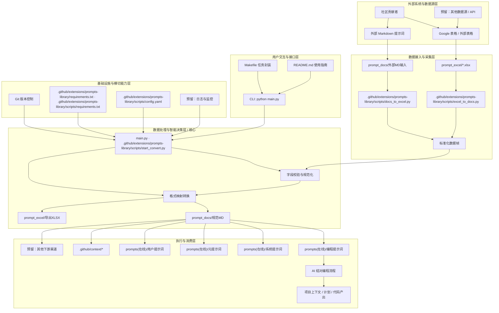
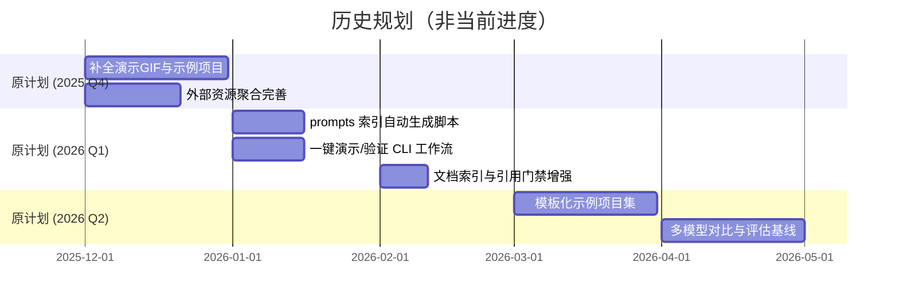

<!--
-------------------------------------------------------------------------------
  项目头部区域 (HEADER)
-------------------------------------------------------------------------------
-->
<div align="center">

<a id="vibe-coding-指南"></a>

# vibe-coding-cn：Vibe Coding工具箱

**以Pi Agent与OpenAI GPT为主体底座，将既有Context、Skills和Extensions组合成可验证的工作流。**

<!--
  徽章区域 (BADGES)
-->
<!-- 单一徽章行：紧凑标签，原链接与完整说明保留在href/alt。 -->
<p>
  <a href="LICENSE"></a>
  <a href="https://t.me/glue_coding"></a>
  <a href=".github/context/gongfa/README.md#原文文集"></a>
  <a href=".github/context/research/README.md"></a>
  <a href=".github/context/getting-started/learning-map.md"></a>
  <a href=".github/extensions/codex-config/.codex/README.md"></a>
  <a href=".github/skills/README.md#当前保留"></a>
  <a href=".github/context/prompts/README.md#在线提示词库"></a>
  <a href=".github/context/assets/README.md#外部资源本地注册表"></a>
  <a href="https://github.com/tukuaiai/vibe-coding-cn/wiki"></a>
  <a href=".github/context/gongfa/README.md#全部记录"></a>
  <a href=".github/context/gongfa/data.json"></a>
  <a href="https://zread.ai/tukuaiai/vibe-coding-cn/1-overview"></a>
</p>

</div>

## 工具箱怎么用

先说明要解决的问题、输入、验收和权限，再从三个资源域挑已有对象，不先造新工具：

| 资源域 | 输入与输出 | 既有内容与代价 |
|---|---|---|
| [Context](.github/context/README.md) | 问题与来源→可核对的参考材料 | 功法、法器、入门、研究、提示词与资源；需付出检索、上下文和来源核对成本 |
| [Skills](.github/skills/README.md) | 任务与参考→可遵循的指令/流程 | 2个自有及16个既有官方Skill；适用范围、依赖和错误判断仍须核实 |
| [Extensions](.github/extensions/README.md) | 显式参数/文件→产物、退出码或外部副作用 | 原程序、脚本、转换器与适配；运行有环境、资源、权限和恢复代价 |

**统一说明约定**：每次选用工具，问清问题是什么、为何这样设计、怎样实现、代价是什么；再比较替代方案、可复用共性和生效前提。
这不是新增工具注册表，也不把资料行、运行实例、抽象依赖类别和程序源码混成一种身份。

**组合方式**：借鉴Lambda演算，用`f: Input → Result`表达接口，只有前一步结果满足后一步输入条件时才组合`λx. g(f(x))`。
真实程序的错误、环境、权限及副作用另列；这个记号不证明纯函数、确定性、正确性或终止，不在仓内实现解释器。

主体执行复用Pi的原生工具与模型选择，使用已授权的OpenAI GPT；没有新建Agent、模型HTTP客户端或Pi内置扩展副本。
资料与官方Skill可读取不代表已运行、已获许可或有效果证明。

<a id="gongfa"></a>
<!-- 其他方法历史定位收口到功法；六命题旧锚点仅作兼容，正文入口在功法体系。 -->
<a id="dao-fa-shu-qi"></a>
<a id="tools"></a>
<a id="经验"></a>
<a id="实验性方法"></a>
<a id="道法术器"></a>
<a id="修仙解释图层"></a>

<details>
<summary><strong>📚 功法体系</strong></summary>

## 功法体系

思想、准则、思维模型、方法与工程流程统一从[功法体系](.github/context/gongfa/README.md)按当前问题选用。
原来的经验、道法术器、实验性方法和哲学保留为同一集合中的原始文集，不再作为首页独立栏目或分库入口。

逐条身份、内容版本、冻结来源与已有意见查看[功法原始资料](.github/context/gongfa/data.json)及[生成总表](.github/context/gongfa/README.md#全部记录)。
文集归并不等于全部内容已经逐条登记；已有初评也不等于正式效果验证。

</details>

<a id="faqi"></a>
<details>
<summary><strong>🧰 法器体系</strong></summary>

## 法器体系

法器总表整理 Vibe Coding 流程中使用或依赖的工具、可调用入口和依赖类别；固定来源实现、当前运行实例、候选对象与抽象类别分别记录。文件级许可线索仅作支持证据，不等于许可批准或再分发授权。

- [法器体系说明](.github/context/faqi/README.md#doc-faqi-system)：分类边界、重要性分级、选用方式与固定 MCP 源码的副作用边界。
- [法器重要性总表](.github/context/faqi/README.md#法器总表)：30 项的品级、名称、说明与记录状态。
- [法器登记源](.github/context/faqi/data.json)：唯一可编辑数据源；生成总表不可手改。
- [法器类型与正式效能规约](.github/context/gongfa/README.md#doc-cultivation-ontology-taxonomy-法器品级规约)：正式任务效果量表仍为草案。

当前 30 项按 Vibe Coding 重要性暂分天阶 4 项、地阶 12 项、玄阶 9 项、黄阶 5 项。重要性不代表实现质量、运行可用性或效能验证；正式效能评级尚未完成。

</details>

<a id="ai-six-propositions"></a>
<a id="ai-five-propositions"></a>
<a id="ai-three-propositions"></a>
<a id="六条核心命题"></a>

<a id="root-tldr"></a>

<details>
<summary><strong>📌 字多不看</strong></summary>

## 📌 字多不看

- `vibe-coding-cn` 是Vibe Coding工具箱，主体底座为Pi Agent与OpenAI GPT；本次只整理已有资产，不增加业务Skill。
- 新手先走 [从零开始完整入门](.github/context/getting-started/learning-map.md)：网络环境、CLI 配置、开发环境、第一个项目和 Git 闭环。
- 方法正文统一在 [功法体系](.github/context/gongfa/README.md)：按问题选择思想、准则、模型与工程方法，不按旧栏目分库。
- 资源统一为Context、Skills、Extensions；用现有测试、CI、脚本、类型、Schema与Git核对具体结果，不把分类当作运行或效果证明。
- 需要直接使用资源时，进入 [提示词](.github/context/prompts/README.md#在线提示词库)、[Skills](.github/skills/README.md#当前保留) 和 [外部资源](.github/context/assets/README.md#外部资源本地注册表)。

### 入口关系

| 入口 | 你该怎么理解 |
|:---|:---|
| [Context](.github/context/README.md) | 既有资料按需读取；功法、法器、入门、研究、提示词、资源、引用、索引及附件 |
| [Skills](.github/skills/README.md) | 所有既有Skill平铺治理；指令引用单一程序源，不自动执行 |
| [Extensions](.github/extensions/README.md) | 所有既有程序、小工具、检查器与适配；不是Pi原生扩展盲扫目录 |
| [Wiki](https://github.com/tukuaiai/vibe-coding-cn/wiki) | 独立导航仓库，不作为第四种资源或第二份正文源 |

</details>

<a id="getting-started"></a>

<details>
<summary><strong>⚡ 1 分钟快速开始</strong></summary>

## ⚡ 1 分钟快速开始

1. 准备当前系统可用的Pi Agent及已授权OpenAI GPT模型，通过Pi原生模型选择配置；不把ChatGPT订阅自动等同于API权限，也不在仓内保存凭据。
2. 获取本仓并按锁定修订初始化既有来源：`git submodule update --init --recursive`。
3. 阅读根`AGENTS.md`和当前任务所需Context；需要既有Skill时，从仓库根显式加载：

```bash
pi --skill .github/skills
```

4. 用Pi原生`/model`选择已授权的OpenAI模型。先明确任务和验收，再让Agent按需读取资料、使用相应Skill并显式调用现有程序。

加载不是执行许可，也不是运行或效果测试。不要把`.github/extensions/`整体传给`-e`。
既有[Codex配置](.github/extensions/codex-config/.codex/README.md)和[从零开始](.github/context/getting-started/README.md)仍保留，按其中具体工具选择使用，不是新造第二套主体运行时。

### 🚀 从零开始

完全新手？按顺序完成以下步骤：

0. [从零开始完整入门](.github/context/getting-started/learning-map.md) - 按目标选择新手、开发者、团队、Prompt、Skill 或质量门禁路线
1. [Vibe Coding 经验](.github/context/gongfa/README.md#doc-vibe-coding-experience) - 通用语言能力、人机分工、机器门禁和入门铁律
2. [第一个项目](.github/context/getting-started/first-project.md) - 用本地待办清单走通需求、实现、验收和 Git 保存
3. [问题求解](.github/context/gongfa/README.md#doc-problem-solving) - “目标-现状-差距-标准”与“目标-约束-对象-路径”的极简框架
4. [Vibe Coding 状态转移闭环](.github/context/gongfa/README.md#doc-vibe-coding-state-transition) - 用固定目标、可变策略和分层反馈统一理解 Vibe Coding
5. [拼好码](.github/context/gongfa/README.md#doc-glue-coding) - 优先复用成熟能力，用胶水代码连接、编排、适配业务流程
6. [工程实践](.github/context/gongfa/README.md#doc-quality-gates-and-pitfalls) - 用项目架构、代码组织、开发经验和硬门禁约束 AI 输出

</details>

<details>
<summary><strong>🗂️ 项目目录结构概览</strong></summary>

## 🗂️ 项目目录结构概览

资源只有三个域；下面列出域边界与Context的全部9个集合，不展开各原生包内部源码。完整对象分别在三个域的README中导航。
原Actions定义已移入Extensions保全，自动CI、打标签及欢迎流程已停用；本地`make test`保留。

```
.
├── README.md                    # 项目主文档
├── AGENTS.md                    # AI Agent 行为准则
├── llms.txt                     # 面向 AI 助手的短上下文入口
├── Makefile                     # 自动化脚本
├── LICENSE                      # MIT 许可证
├── CODE_OF_CONDUCT.md           # 行为准则
├── CONTRIBUTING.md              # 贡献指南
├── .gitattributes               # GitHub Linguist 语言统计规则
├── .gitignore                   # Git 忽略规则
├── .lychee.toml                 # 外部链接检查配置
└── .github/                     # GitHub 配置与仓库内容
    ├── AGENTS.md                # 本目录规则和平台边界
    ├── context/                 # 按需读取的既有资料
    │   ├── README.md            # 资料导航
    │   ├── AGENTS.md            # 原始数据、来源与信任规则
    │   ├── gongfa/              # data.json + 生成README.md
    │   ├── faqi/                # data.json + 生成README.md
    │   ├── getting-started/     # 原入门与实例
    │   ├── prompts/             # 原云端提示词入口
    │   ├── research/            # 原研究、事实镜像和缓存
    │   ├── external-resources/  # 原外部资源登记
    │   ├── ai-citation/         # 原AI引用语料
    │   ├── metadata/            # 原分类、术语与重定向
    │   └── assets/              # 原图片、数据与模板
    ├── skills/                  # 2个自有 + 16个既有官方入口
    ├── extensions/              # 原程序、脚本、小工具和适配
    ├── CODEOWNERS               # 路径级 owner 评审基线
    ├── ISSUE_TEMPLATE/          # Issue 模板
    ├── PULL_REQUEST_TEMPLATE.md # PR 模板
    ├── SECURITY.md              # 安全政策
    ├── FUNDING.yml              # 赞助配置
    ├── WIKI.md                  # GitHub Wiki 独立仓库说明
    └── labeler.yml              # 原PR标签规则（自动流程已停用）
```

</details>

<details>
<summary><strong>📺 演示与产出</strong></summary>

## 📺 演示与产出

一句话：Vibe Coding = **规划驱动 + 上下文固定 + AI 结对执行**，让「从想法到可维护代码」变成一条可审计的流水线，而不是一团无法迭代的巨石文件。

**你能得到**
- 成体系的提示词工具链：[云端表格](https://docs.google.com/spreadsheets/d/1Ifk_dLF25ULSxcfGem1hXzJsi7_RBUNAki8SBCuvkJA/edit?gid=1254297203#gid=1254297203) 提供系统提示词约束 AI 行为边界，编程提示词提供需求澄清、计划、执行的全链路脚本。
- 闭环交付路径：需求 → 上下文文档 → 实施计划 → 分步实现 → 自测 → 进度记录，全程可复盘、可移交。

<details>
<summary><strong>⚙️ 架构与工作流程</strong></summary>

## ⚙️ 架构与工作流程

核心资产映射是`context/`的资料、`skills/`的指令和`extensions/`的现有实现。相邻步骤按输入输出合同连接，失败和外部副作用不能隐去。

下面保留既有提示词转换程序的架构示意；图中的历史预留节点不是本次新增能力，也不代表整个工具箱均采用该转换流程。



</details>

<details>
<summary><strong>📈 性能基准 (可选)</strong></summary>

## 📈 性能基准 (可选)

本仓库是既有资源工具箱，不对模型或程序效果作统一性能保证；可在具体任务中跟踪下列可观测指标（当前主要依赖人工记录，可在 `progress.md` 中打分/留痕）：

| 指标 | 含义 | 当前状态/建议 |
|:---|:---|:---|
| 提示命中率 | 一次生成即满足验收的比例 | 待记录；每个任务完成后在 progress.md 记 0/1 |
| 周转时间 | 需求 → 首个可运行版本所需时间 | 录屏时标注时间戳，或用 CLI 定时器统计 |
| 变更可复盘度 | 是否同步更新上下文、文档和 Git 提交 | 通过 commit、CHANGELOG 与必要的 tag 留痕 |
| 例程覆盖 | 是否有最小可运行示例/测试 | 建议每个示例项目保留 README+测试用例 |

</details>

## 🗺️ 路线图

以下是 **2025 Q4–2026 Q2 的历史规划**，不代表当前进度或交付承诺；原日期仅用于回溯。
当前交付以仓内文档、代码与[提交记录](https://github.com/tradecatlabs/vibe-coding-cn/commits/main/)为准，新排期待确认。



</details>

<a id="contact"></a>

<details>
<summary><strong>📞 研究交流</strong></summary>

## 📞 研究交流

-   **Twitter / X**: [123olp](https://x.com/123olp)
-   **Telegram 交流群**: [glue_coding](https://t.me/glue_coding)
-   **Telegram 频道**: [tradecat_ai_channel](https://t.me/tradecat_ai_channel)
-   **邮箱**: tukuai.ai@gmail.com

</details>

<a id="support"></a>

<details>
<summary><strong>✨ 支持项目</strong></summary>

## ✨ 支持项目

救救孩子，好人一生平安🙏🙏🙏

-   **Tron (TRC20)**: `TQtBXCSTwLFHjBqTS4rNUp7ufiGx51BRey`
-   **Ethereum (ERC20)**: `0xa396923a71ee7D9480b346a17dDeEb2c0C287BBC`
-   **Bitcoin**: `bc1plslluj3zq3snpnnczplu7ywf37h89dyudqua04pz4txwh8z5z5vsre7nlm`

</details>

<details>
<summary><strong>✨ 贡献者</strong></summary>

## ✨ 贡献者

感谢所有为本项目做出贡献的开发者！

<a href="https://github.com/tradecatlabs/vibe-coding-cn/graphs/contributors">
  
</a>

<p>特别鸣谢以下成员的宝贵贡献 (排名不分先后):<br/>
<a href="https://x.com/shao__meng">@shao__meng</a> |
<a href="https://x.com/0XBard_thomas">@0XBard_thomas</a> |
<a href="https://x.com/Pluvio9yte">@Pluvio9yte</a> |
<a href="https://x.com/xDinoDeer">@xDinoDeer</a> |
<a href="https://x.com/geekbb">@geekbb</a> |
<a href="https://x.com/GitHub_Daily">@GitHub_Daily</a> |
<a href="https://x.com/BiteyeCN">@BiteyeCN</a> |
<a href="https://x.com/CryptoJHK">@CryptoJHK</a> |
<a href="https://github.com/tukuaiai">@tukuaiai</a> |
<a href="https://github.com/tradecatlabs">@tradecatlabs</a> |
<a href="https://github.com/apps/factory-droid">@factory-droid[bot]</a> |
<a href="https://github.com/Scuner">@Scuner</a>
</p>

</details>

<div align="center">

---

**如果这个项目对您有帮助，请考虑为其点亮一颗 Star ⭐！**

## Star History

<a href="https://www.star-history.com/#tukuaiai/vibe-coding-cn&type=date&legend=top-left">
 <picture>
   <source media="(prefers-color-scheme: dark)" srcset="https://api.star-history.com/svg?repos=tukuaiai/vibe-coding-cn&type=date&theme=dark&legend=top-left" />
   <source media="(prefers-color-scheme: light)" srcset="https://api.star-history.com/svg?repos=tukuaiai/vibe-coding-cn&type=date&legend=top-left" />
   
 </picture>
</a>

[⬆ 返回顶部](#vibe-coding-指南)
</div>
