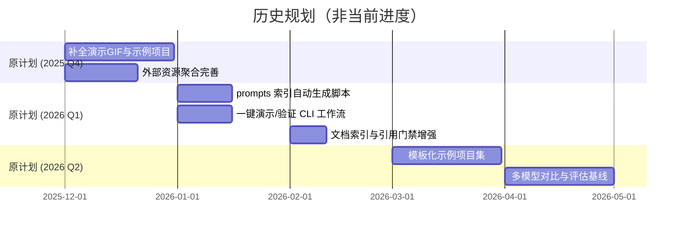

<!--
-------------------------------------------------------------------------------
  项目头部区域 (HEADER)
-------------------------------------------------------------------------------
-->
<div align="center">

<a id="vibe-coding-指南"></a>

# vibe-coding-cn：中文 Vibe Coding 从入门到精通教程

**从想法到产品的 AI 结对编程工作流标准：Prompt + Skill + Context + Quality Gate + 工程闭环**

<!--
  徽章区域 (BADGES)
-->
<!-- 单一徽章行：紧凑标签，原链接与完整说明保留在href/alt。 -->
<p>
  <a href="LICENSE"></a>
  <a href="https://t.me/glue_coding"></a>
  <a href=".github/docs/gongfa/README.md"></a>
  <a href=".github/research/README.md"></a>
  <a href=".github/docs/getting-started/learning-map.md"></a>
  <a href=".github/tools/config/.codex/README.md"></a>
  <a href=".github/skills/README.md#当前保留"></a>
  <a href=".github/prompts/README.md#在线提示词库"></a>
  <a href=".github/assets/README.md#外部资源本地注册表"></a>
  <a href="https://github.com/tukuaiai/vibe-coding-cn/wiki"></a>
  <a href=".github/metadata/gongfa/catalog.md"></a>
  <a href=".github/metadata/gongfa/catalog.xlsx"></a>
  <a href="https://zread.ai/tukuaiai/vibe-coding-cn/1-overview"></a>
</p>

</div>

<a id="gongfa"></a>
<!-- 其他方法历史定位收口到功法；六命题旧锚点仅作兼容，正文入口在功法体系。 -->
<a id="dao-fa-shu-qi"></a>
<a id="tools"></a>
<a id="经验"></a>
<a id="实验性方法"></a>
<a id="道法术器"></a>
<a id="修仙解释图层"></a>

<details>
<summary><strong>📚 功法体系</strong></summary>

## 功法体系

思想、准则、思维模型、方法与工程流程统一从[功法体系](.github/docs/gongfa/README.md)按当前问题选用。
原来的经验、道法术器、实验性方法和哲学都在体系内维护，不再作为首页独立栏目或分库入口。

逐条身份、内容版本、冻结来源与已有意见查看[功法登记](.github/metadata/gongfa/README.md)及上方总表。
文集归并不等于全部内容已经逐条登记；已有初评也不等于正式效果验证。

</details>

<a id="faqi"></a>
<details>
<summary><strong>🧰 法器体系</strong></summary>

## 法器体系

法器总表整理 Vibe Coding 流程中使用或依赖的工具、可调用入口和依赖类别；固定来源实现、当前运行实例、候选对象与抽象类别分别记录。文件级许可线索仅作支持证据，不等于许可批准或再分发授权。

- [法器体系说明](.github/docs/gongfa/faqi-system.md)：分类边界、重要性分级、选用方式与固定 MCP 源码的副作用边界。
- [法器重要性总表](.github/tools/faqi-catalog.md)：30 项的品级、名称、说明与记录状态。
- [法器登记源](.github/metadata/faqi.json)：唯一可编辑数据源；生成总表不可手改。
- [法器类型与正式效能规约](.github/docs/gongfa/cultivation-ontology-taxonomy.md#法器品级规约)：正式任务效果量表仍为草案。

当前 30 项按 Vibe Coding 重要性暂分天阶 4 项、地阶 12 项、玄阶 9 项、黄阶 5 项。重要性不代表实现质量、运行可用性或效能验证；正式效能评级尚未完成。

</details>

<a id="ai-six-propositions"></a>
<a id="ai-five-propositions"></a>
<a id="ai-three-propositions"></a>
<a id="六条核心命题"></a>

<a id="root-tldr"></a>

<details>
<summary><strong>📌 字多不看</strong></summary>

## 📌 字多不看

- `vibe-coding-cn` 是中文 Vibe Coding 从入门到精通教程，目标是把想法稳定变成可运行产品。
- 新手先走 [从零开始完整入门](.github/docs/getting-started/learning-map.md)：网络环境、CLI 配置、开发环境、第一个项目和 Git 闭环。
- 方法正文统一在 [功法体系](.github/docs/gongfa/README.md)：按问题选择思想、准则、模型与工程方法，不按旧栏目分库。
- 工程主线是 Prompt、Skill、Context、Quality Gate 和 Git，用测试、CI、脚本、类型、schema、清单约束 AI 输出。
- 需要直接使用资源时，进入 [提示词](.github/prompts/README.md#在线提示词库)、[Skills](.github/skills/README.md#当前保留) 和 [外部资源](.github/assets/README.md#外部资源本地注册表)。

### 入口关系

| 入口 | 你该怎么理解 |
|:---|:---|
| [docs](.github/docs/README.md) | 知识库总入口，先从这里选择学习路线 |
| [getting-started](.github/docs/getting-started/README.md) | 新手启动入口，配置网络、Codex CLI、开发环境，完成第一个项目和 Git 闭环 |
| [gongfa](.github/docs/gongfa/README.md) | 思想、准则、模型、方法与工程流程的唯一正文入口 |
| [research](.github/research/README.md) | 研究入口，记录新技术、优秀 repo 和工程趋势判断 |
| [prompts](.github/prompts/README.md) | 提示词入口，复用和管理提示词资产 |
| [skills](.github/skills/README.md) | 技能入口，复用可执行的 AI 能力模块 |
| [tools](.github/tools/README.md) | 工具入口，使用 Codex 配置、转换工具和外部工具 |
| [assets](.github/assets/README.md) | 资源入口，查看外部资源、AI 引用语料和静态资产 |
| [Wiki](https://github.com/tukuaiai/vibe-coding-cn/wiki) | 导航入口，用摘要页串联主仓 docs、tools、prompts、skills 和 GEO 资产 |

</details>

<a id="getting-started"></a>

<details>
<summary><strong>⚡ 1 分钟快速开始</strong></summary>

## ⚡ 1 分钟快速开始

> 新电脑也可以开始：先用网页 AI 这个零依赖入口，生成适合你系统的网络环境、Codex CLI 和本地 Agent 安装步骤。

**第 1 步**：复制下面的提示词，粘贴到 [ChatGPT](https://chatgpt.com/) / Claude / Gemini 网页版

```
你是一个专业的 AI 编程环境配置助手。我要从新电脑开始学习 Vibe Coding。

请先问我：
1. 我的操作系统是什么？Windows 11 / WSL / Linux / macOS？
2. 我是否已经能访问 OpenAI、GitHub、Node.js/npm 和系统包管理器？
3. 我是否已有可用的 Codex / ChatGPT 订阅？

然后帮我：
1. 先判断网络环境和订阅是否满足 Codex CLI 前置条件。
2. 按我的系统生成从 0 到 1 安装 Codex CLI 的步骤。
3. 每条需要在终端执行的命令都单独放在代码块里。
4. Codex CLI 登录成功后，告诉我如何让本地 Agent 继续配置 Git、Node.js、Python、编辑器、项目依赖、测试命令和 Git 工作流。
5. 如果我贴报错，请逐条解释原因并给出下一条最小修复命令。

要求：不要跳步；每一步只做一件事；每一步都说明如何判断成功。
```

**第 2 步**：按网页 AI 生成的步骤先装好 Codex CLI。

**第 3 步**：Codex CLI 跑通后，让本地 Agent 读取本仓库文档并主动配置剩余环境。

**核心口径**：网页 AI 是零依赖启动器，Codex CLI 是默认本地执行入口。更多内容（新手从零开始）请继续阅读 👇

### 🚀 从零开始

完全新手？按顺序完成以下步骤：

0. [从零开始完整入门](.github/docs/getting-started/learning-map.md) - 按目标选择新手、开发者、团队、Prompt、Skill 或质量门禁路线
1. [Vibe Coding 经验](.github/docs/gongfa/vibe-coding-experience.md) - 通用语言能力、人机分工、机器门禁和入门铁律
2. [第一个项目](.github/docs/getting-started/first-project.md) - 用本地待办清单走通需求、实现、验收和 Git 保存
3. [问题求解](.github/docs/gongfa/problem-solving.md) - “目标-现状-差距-标准”与“目标-约束-对象-路径”的极简框架
4. [Vibe Coding 状态转移闭环](.github/docs/gongfa/vibe-coding-state-transition.md) - 用固定目标、可变策略和分层反馈统一理解 Vibe Coding
5. [拼好码](.github/docs/gongfa/glue-coding.md) - 优先复用成熟能力，用胶水代码连接、编排、适配业务流程
6. [工程实践](.github/docs/gongfa/quality-gates-and-pitfalls.md) - 用项目架构、代码组织、开发经验和硬门禁约束 AI 输出

</details>

<details>
<summary><strong>🗂️ 项目目录结构概览</strong></summary>

## 🗂️ 项目目录结构概览

本项目 `vibe-coding-cn` 的核心结构主要围绕知识管理、AI 提示词的组织与自动化展开。以下是经过整理和简化的目录树及各部分说明：

```
.
├── README.md                    # 项目主文档
├── AGENTS.md                    # AI Agent 行为准则
├── llms.txt                     # 面向 AI 助手的短上下文入口
├── Makefile                     # 自动化脚本
├── LICENSE                      # MIT 许可证
├── CODE_OF_CONDUCT.md           # 行为准则
├── CONTRIBUTING.md              # 贡献指南
├── .gitattributes               # GitHub Linguist 语言统计规则
├── .gitignore                   # Git 忽略规则
├── .lychee.toml                 # 外部链接检查配置
└── .github/                     # GitHub 配置与仓库内容
    ├── AGENTS.md                # 本目录规则和平台边界
    ├── assets/                  # 静态资产、外部资源与 AI 引用语料
    ├── docs/                    # 入门教程与功法正文
    ├── metadata/                # 机器可读登记与生成目录
    ├── prompts/                 # 提示词库入口
    ├── research/                # 研究对象、来源事实和冻结材料
    ├── scripts/                 # 检查、生成和维护脚本
    ├── skills/                  # 可复用技能库
    ├── tools/                   # 工具、配置与外部依赖
    ├── CODEOWNERS               # 路径级 owner 评审基线
    ├── ISSUE_TEMPLATE/          # Issue 模板
    ├── PULL_REQUEST_TEMPLATE.md # PR 模板
    ├── SECURITY.md              # 安全政策
    ├── FUNDING.yml              # 赞助配置
    ├── WIKI.md                  # GitHub Wiki 独立仓库说明
    ├── labeler.yml              # PR 标签规则
    └── workflows/               # GitHub Actions 工作流（含新贡献者欢迎）
```

</details>

<details>
<summary><strong>📺 演示与产出</strong></summary>

## 📺 演示与产出

一句话：Vibe Coding = **规划驱动 + 上下文固定 + AI 结对执行**，让「从想法到可维护代码」变成一条可审计的流水线，而不是一团无法迭代的巨石文件。

**你能得到**
- 成体系的提示词工具链：[云端表格](https://docs.google.com/spreadsheets/d/1Ifk_dLF25ULSxcfGem1hXzJsi7_RBUNAki8SBCuvkJA/edit?gid=1254297203#gid=1254297203) 提供系统提示词约束 AI 行为边界，编程提示词提供需求澄清、计划、执行的全链路脚本。
- 闭环交付路径：需求 → 上下文文档 → 实施计划 → 分步实现 → 自测 → 进度记录，全程可复盘、可移交。

<details>
<summary><strong>⚙️ 架构与工作流程</strong></summary>

## ⚙️ 架构与工作流程

核心资产映射：
```
.github/prompts/
  README.md  # 云端表格入口（元/系统/编程/用户提示词）
.github/skills/
  README.md  # skills 总览与索引
.github/docs/
  getting-started/*  # 配置与实例练习
  gongfa/*           # 统一方法正文与配套文集
.github/research/
  README.md  # 研究总索引、治理契约、迁移综合与研究对象入口
.github/assets/
  README.md  # 静态资产与外部资源入口
  external-resources/  # 本地外部资源注册表
.github/scripts/
  README.md  # 自动化入口、验证命令与脚本职责索引
  check-local-links.py  # Markdown 相对链接检查脚本
  test-markdown-details.py  # 代码围栏隔离与折叠块错误的 CLI 回归
```


</details>

<details>
<summary><strong>📈 性能基准 (可选)</strong></summary>

## 📈 性能基准 (可选)

本仓库定位为「流程与提示词」而非性能型代码库，建议跟踪下列可观测指标（当前主要依赖人工记录，可在 `progress.md` 中打分/留痕）：

| 指标 | 含义 | 当前状态/建议 |
|:---|:---|:---|
| 提示命中率 | 一次生成即满足验收的比例 | 待记录；每个任务完成后在 progress.md 记 0/1 |
| 周转时间 | 需求 → 首个可运行版本所需时间 | 录屏时标注时间戳，或用 CLI 定时器统计 |
| 变更可复盘度 | 是否同步更新上下文、文档和 Git 提交 | 通过 commit、CHANGELOG 与必要的 tag 留痕 |
| 例程覆盖 | 是否有最小可运行示例/测试 | 建议每个示例项目保留 README+测试用例 |

</details>

## 🗺️ 路线图

以下是 **2025 Q4–2026 Q2 的历史规划**，不代表当前进度或交付承诺；原日期仅用于回溯。
当前交付以仓内文档、代码与[提交记录](https://github.com/tradecatlabs/vibe-coding-cn/commits/main/)为准，新排期待确认。



</details>

<a id="contact"></a>

<details>
<summary><strong>📞 研究交流</strong></summary>

## 📞 研究交流

-   **Twitter / X**: [123olp](https://x.com/123olp)
-   **Telegram 交流群**: [glue_coding](https://t.me/glue_coding)
-   **Telegram 频道**: [tradecat_ai_channel](https://t.me/tradecat_ai_channel)
-   **邮箱**: tukuai.ai@gmail.com

</details>

<a id="support"></a>

<details>
<summary><strong>✨ 支持项目</strong></summary>

## ✨ 支持项目

救救孩子，好人一生平安🙏🙏🙏

-   **Tron (TRC20)**: `TQtBXCSTwLFHjBqTS4rNUp7ufiGx51BRey`
-   **Ethereum (ERC20)**: `0xa396923a71ee7D9480b346a17dDeEb2c0C287BBC`
-   **Bitcoin**: `bc1plslluj3zq3snpnnczplu7ywf37h89dyudqua04pz4txwh8z5z5vsre7nlm`

</details>

<details>
<summary><strong>✨ 贡献者</strong></summary>

## ✨ 贡献者

感谢所有为本项目做出贡献的开发者！

<a href="https://github.com/tradecatlabs/vibe-coding-cn/graphs/contributors">
  
</a>

<p>特别鸣谢以下成员的宝贵贡献 (排名不分先后):<br/>
<a href="https://x.com/shao__meng">@shao__meng</a> |
<a href="https://x.com/0XBard_thomas">@0XBard_thomas</a> |
<a href="https://x.com/Pluvio9yte">@Pluvio9yte</a> |
<a href="https://x.com/xDinoDeer">@xDinoDeer</a> |
<a href="https://x.com/geekbb">@geekbb</a> |
<a href="https://x.com/GitHub_Daily">@GitHub_Daily</a> |
<a href="https://x.com/BiteyeCN">@BiteyeCN</a> |
<a href="https://x.com/CryptoJHK">@CryptoJHK</a> |
<a href="https://github.com/tukuaiai">@tukuaiai</a> |
<a href="https://github.com/tradecatlabs">@tradecatlabs</a> |
<a href="https://github.com/apps/factory-droid">@factory-droid[bot]</a> |
<a href="https://github.com/Scuner">@Scuner</a>
</p>

</details>

<div align="center">

---

**如果这个项目对您有帮助，请考虑为其点亮一颗 Star ⭐！**

## Star History

<a href="https://www.star-history.com/#tukuaiai/vibe-coding-cn&type=date&legend=top-left">
 <picture>
   <source media="(prefers-color-scheme: dark)" srcset="https://api.star-history.com/svg?repos=tukuaiai/vibe-coding-cn&type=date&theme=dark&legend=top-left" />
   <source media="(prefers-color-scheme: light)" srcset="https://api.star-history.com/svg?repos=tukuaiai/vibe-coding-cn&type=date&legend=top-left" />
   
 </picture>
</a>

[⬆ 返回顶部](#vibe-coding-指南)
</div>
